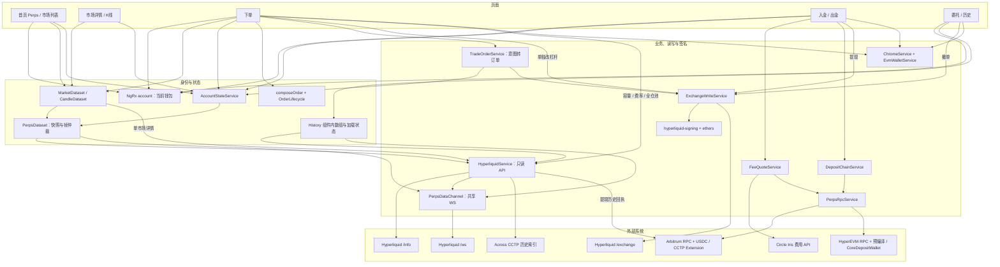
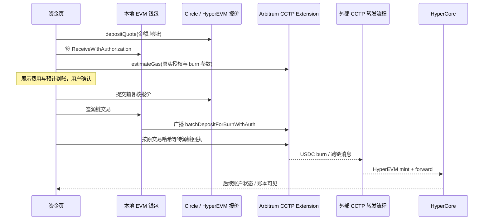

# NeoLine Perps 功能地图

代码梳理基线：2026-09-23，分支 `feature/perps`，提交 `368b1bc0` 及当时工作区。2026-09-24 在提交 `8a5efac9` 基础上归并文档入口和共享约定，并核对相关实现；没有连接真实账户、发送签名、发起交易或验证线上合约部署。

**整体定位：NeoLine 内嵌的 Hyperliquid 永续交易客户端。** 钱包提供地址与签名能力，Hyperliquid 提供市场、账户和订单执行，Arbitrum/Circle CCTP 提供 USDC 资金通道。交易撮合、清算和跨链转发由外部系统执行。

下文的函数链接均指向文件及本轮核对的行号；行号随后续修改可能变化，函数名可用于重新定位。

本文是 Perps 文档总入口：[页面职责与阅读入口](#page-map)、[共享术语与约定](#shared-contracts)、[文档维护与验证记录](#documentation)。具体页面行为、计算、异常与验收方案由各页面 README 维护。

## 1. 入口与支持范围

| 项目 | 当前实现 | 文件与函数位置 |
| --- | --- | --- |
| 钱包入口 | 首页仅在 `NeoX` 钱包类型下展示 Perps；使用钱包内当前 EVM 地址，没有独立 WalletConnect 连接流程 | [PopupHomeComponent.setTab](../home/home.component.ts#L116)、[showPerps](../home/home.component.ts#L133)；[PerpsFundingGuard.canActivate](perps-funding/perps-funding.guard.ts#L14) |
| 路由 | 首页 `/popup/home?tab=perps`；子页面 `/popup/perps/markets`、`market/:coin`、`order/:coin`、`funding`、`history` | [perps 父路由](../popup.route.ts#L94)、[routes](perps.route.ts#L11) |
| 交易网络 | Perps 网络独立于钱包当前选择的 NeoX RPC 网络；生产构建强制主网，开发构建可配置 testnet | [resolvePerpsTestnet](../_lib/perps.ts#L34)、[HYPERLIQUID_API](../_lib/perps.ts#L41) |
| 市场范围 | 标准永续 DEX `''` 与白名单 HIP-3 DEX `xyz`；不遍历注册表开放全部 DEX | [HyperliquidService.enabledDexes](../../core/services/perps/hyperliquid.service.ts#L128)、[PERPS_HIP3_DEXES](../_lib/perps.ts#L61) |
| 市场身份 | `coin` 保留 HIP-3 前缀，例如 `xyz:...`；模型 key 为 `hl:SYMBOL` 或 `dex:SYMBOL`。标准 assetId 为原始 universe 下标；HIP-3 为 `100000 + dexIndex × 10000 + index` | [buildMarket](../../core/services/perps/perps-market-dataset.ts#L107) |
| 可签名钱包 | 当前写入链路使用本地可导出的 EVM 私钥；Ledger / QR 钱包在交易、撤单、杠杆和资金写入处被拦截 | [PerpsOrderComponent.submit](perps-order/perps-order.component.ts#L1097)、[PerpsHistoryComponent.cancel](perps-history/perps-history.component.ts#L319)、[signingUnavailable](perps-funding/perps-funding.component.ts#L388)、[EvmWalletService.getPrivateKey](../../core/services/evm/wallet.service.ts#L106) |

## 2. 功能清单：从入口追到执行端

“页面可用”表示当前存在 UI 调用路径，不表示已完成真实网络验收。

| 功能 | 实际行为与边界 | 页面/入口 | 核心实现与外部依赖 |
| --- | --- | --- | --- |
| 当前钱包与账户切换 | 读取 NgRx `account.currentWallet.accounts[0].address`；下单页换地址后退出当前页面 | [Tab.ngOnInit](perps-tab/perps-tab.component.ts#L60)、[Order.ngOnInit](perps-order/perps-order.component.ts#L268) | [AccountState](../../reduers/components/account.ts#L39)；[watchAccount](../../core/services/perps/perps-account-state.service.ts#L126) / [watchAggregatedAccount](../../core/services/perps/perps-account-state.service.ts#L161) → Hyperliquid |
| 市场列表、搜索、排序 | 搜索展示符号；按成交量或涨幅降序；NEO/GAS 产品置顶；分批展示 | [shownMarkets](perps-market-list/perps-market-list.component.ts#L243)、[comparator](perps-market-list/perps-market-list.component.ts#L286)、[loadMore](perps-market-list/perps-market-list.component.ts#L204) | [watchMarkets](../../core/services/perps/perps-market-dataset.service.ts#L148) → `perpDexs`、`metaAndAssetCtxs`、`allDexsAssetCtxs` |
| 市场详情与 K 线 | 中间价、标记价、预言机价、涨跌、成交量、未平仓量、资金费率；K 线/成交量、多周期与历史加载 | [loadMarket](perps-market/perps-market.component.ts#L408)、[watchDataset](perps-market/perps-market.component.ts#L460)、[selectInterval](perps-market/perps-market.component.ts#L545)、[createChart](perps-chart/perps-chart.component.ts#L223) | [watchMarketDetail](../../core/services/perps/perps-market-dataset.service.ts#L190)；[watchDataset](../../core/services/perps/perps-candle-dataset.service.ts#L130) / [loadEarlier](../../core/services/perps/perps-candle-dataset.service.ts#L168) → Hyperliquid；本地 lightweight-charts 渲染 |
| 账户与仓位概览 | 跨已启用 DEX 合并仓位；显示权益/USDC、可用金额，以及方向、数量、入场价、仓位价值、盈亏、杠杆、保证金、强平价 | [watchAccountState](perps-tab/perps-tab.component.ts#L100)、[position](perps-market/perps-market.component.ts#L334) | [parsePerpsAccount](../../core/services/perps/perps-account-state.ts#L52)、[aggregatePerpsAccounts](../../core/services/perps/perps-account-state.ts#L205) → 清算所与现货状态 |
| 开仓 / 普通方向订单 | 做多或做空；金额换算数量；表单生成交易意图并提交。已有反向仓位时仍发普通非 reduce-only 净额订单，可能减仓或穿越零仓位 | [toOrder](perps-market/perps-market.component.ts#L600)、[setSide](perps-order/perps-order.component.ts#L748)、[submit](perps-order/perps-order.component.ts#L1097) | [composeOrder](perps-order/perps-order-composition.ts#L187)、[submit](../../core/services/perps/perps-trade-order.service.ts#L72) / [buildOrder](../../core/services/perps/perps-trade-order.service.ts#L285) → `updateLeverage` + `order` |
| 加仓 | 详情页 `?add=1`；沿用已有方向、模式与杠杆，追加同方向数量 | [addToPosition](perps-market/perps-market.component.ts#L607)、[applySeed](perps-order/perps-order.component.ts#L376) | [operation 判定](perps-order/perps-order-composition.ts#L253) → [submit](../../core/services/perps/perps-trade-order.service.ts#L72) → Hyperliquid |
| 减仓 / 全平 | 详情页 `?close=1`；部分平仓 reduce-only；全平提交前重新读取精确仓位数量；不额外写杠杆 | [closePosition](perps-market/perps-market.component.ts#L615)、[setPercent](perps-order/perps-order.component.ts#L942) | [setsLeverage](../../core/services/perps/perps-trade-order.service.ts#L227)、[resolveSize](../../core/services/perps/perps-trade-order.service.ts#L231)、[positionSize](../../core/services/perps/perps-trade-order.service.ts#L255)、[buildOrder](../../core/services/perps/perps-trade-order.service.ts#L285) |
| 市价单 / 限价挂单 | 当前 UI 只提供市价单，以中间价加滑点边界的 IOC 限价单发送；底层保留 GTC 限价能力，模板没有限价输入入口 | [setOrderType](perps-order/perps-order.component.ts#L760)、[onLimitPriceBlur](perps-order/perps-order.component.ts#L1021) | [buildOrder](../../core/services/perps/perps-trade-order.service.ts#L285) → [submitOrder](../../core/services/perps/perps-exchange-write.service.ts#L195) → Hyperliquid `order` |
| 撤单 | 当前委托列表逐笔操作，再次点击确认；按市场 assetId 与 oid 撤销，成功后移除本地行并继续跟随 WS | [requestCancel](perps-history/perps-history.component.ts#L311)、[cancel](perps-history/perps-history.component.ts#L319) | [cancelOrder](../../core/services/perps/perps-exchange-write.service.ts#L276) → Hyperliquid `cancel` |
| 杠杆 | 普通下单页可调整杠杆倍数；开仓/加仓写单前设置；已有仓位且模式相同时可单独“应用杠杆” | [setLeverage](perps-order/perps-order.component.ts#L766)、[canApplyLeverage](perps-order/perps-order.component.ts#L854)、[applyLeverage](perps-order/perps-order.component.ts#L860) | [submit](../../core/services/perps/perps-trade-order.service.ts#L72)、[updateLeverage](../../core/services/perps/perps-exchange-write.service.ts#L288)；上限来自市场 `maxLeverage`，最终拒绝由交易所返回 |
| 全仓 / 逐仓 | 底层支持两种模式。新仓默认逐仓，已有仓位沿用模式；代码接受 `?marginMode=cross`，当前模板没有独立模式切换控件 | [ngOnInit](perps-order/perps-order.component.ts#L268)、[seedForm 模式分支](perps-order/perps-order-seeding.ts#L69)、[模板杠杆区域](perps-order/perps-order.component.html#L140) | [orderUnavailable](perps-order/perps-order-composition.ts#L659) 校验市场限制与已有仓位模式；[updateLeverage](../../core/services/perps/perps-exchange-write.service.ts#L288) 写 `isCross` |
| 止盈 / 止损 | 非平仓表单可附带 TP、SL 或两者；支持触发价及百分比/金额换算；子单是反方向 reduce-only 市价触发单 | [setProtectionEnabled](perps-order/perps-order.component.ts#L787)、[setProtectionPrice](perps-order/perps-order.component.ts#L793)、[setProtectionReturn](perps-order/perps-order.component.ts#L837) | [buildOrder](../../core/services/perps/perps-trade-order.service.ts#L285) → [submitOrder](../../core/services/perps/perps-exchange-write.service.ts#L195)，父子单同批 `grouping: normalTpsl`；返回子单未确认提示 |
| 滑点与订单校验 | 默认 3%，读取 ChromeService 保存值，合法范围 0.1–10%；当前模板没有滑点设置入口。检查精度、最低名义额、容量和保护价；全平跳过本地最低额预检 | [loadMaxSlippage](perps-order/perps-order.component.ts#L431)、[openSlippageDialog](perps-order/perps-order.component.ts#L1033) | [orderUnavailable](perps-order/perps-order-composition.ts#L659)、[validateIntent](../../core/services/perps/perps-trade-order.service.ts#L141)、[perpsPriceDecimals](../_lib/perps.ts#L192) / [perpsSizeAtLot](../_lib/perps.ts#L219) |
| 入金 | Arbitrum 原生 USDC → CCTP → HyperEVM 转发器 → HyperCore；源链 ETH 支付网络费；代码产品下限 5 USDC | [requestSubmit](perps-funding/perps-funding.component.ts#L761)、[prepareDeposit](perps-funding/perps-funding.component.ts#L254)、[sendDeposit](perps-funding/perps-funding.component.ts#L929) | [depositQuote](../../core/services/perps/perps-fee-quote.service.ts#L90)；[authorizeDeposit](../../core/services/perps/perps-deposit-chain.service.ts#L102) / [sendDeposit](../../core/services/perps/perps-deposit-chain.service.ts#L193)；[PERPS_MIN_DEPOSIT](../_lib/perps.ts#L174) |
| 出金 | HyperCore → HyperEVM/CCTP → Arbitrum 同一地址；标准账户从永续扣款，统一/组合保证金按现货来源；下限按当次费用的两倍计算 | [withdrawableExact](perps-funding/perps-funding.component.ts#L346)、[prepareWithdraw](perps-funding/perps-funding.component.ts#L779)、[submit](perps-funding/perps-funding.component.ts#L833) | [withdrawQuote](../../core/services/perps/perps-fee-quote.service.ts#L189) / [minWithdrawExact](../../core/services/perps/perps-fee-quote.service.ts#L227)；[withdraw](../../core/services/perps/perps-exchange-write.service.ts#L314) → `sendToEvmWithData` |
| 历史记录 | 五栏：当前委托、历史成交、订单历史、资金费、出入金/转账；订单历史/资金费/转账各最多显示 200 行 | [PerpsActivityTab](perps-history/perps-history.component.ts#L28)、[requestFor](perps-history/perps-history.component.ts#L191)、[acceptTab](perps-history/perps-history.component.ts#L204) | [getUserFills](../../core/services/perps/hyperliquid.service.ts#L553)、[getOpenOrders](../../core/services/perps/hyperliquid.service.ts#L566)、[getHistoricalOrders](../../core/services/perps/hyperliquid.service.ts#L598)、[getLedgerUpdates](../../core/services/perps/hyperliquid.service.ts#L612)、[getUserFunding](../../core/services/perps/hyperliquid.service.ts#L664) |
| 未知订单结果恢复 | 保留当前页 cloid，按 1.5 秒间隔最多查询 4 次；仍未知则关闭重复提交入口，提供再查与历史入口 | [unresolved](perps-order/perps-order-lifecycle.ts#L190)、[scheduleQuery](perps-order/perps-order-lifecycle.ts#L222)、[receive](perps-order/perps-order-lifecycle.ts#L237) | [getOrderStatus](../../core/services/perps/perps-exchange-write.service.ts#L355) → Hyperliquid `orderStatus`；[onLifecycleChange](perps-order/perps-order.component.ts#L406) 刷新账户 |

## 3. 架构图：页面 → 状态 → 业务服务 → 外部系统

箭头表示调用或依赖；WS 帧沿订阅向页面返回。图中服务均位于 Angular popup 侧。

图的实现落点：

| 层 | 责任与状态所有权 | 文件/函数 |
| --- | --- | --- |
| NgRx 身份 | 钱包、链类型及网络选择；Perps 行情和仓位没有另设 NgRx reducer | [AccountState](../../reduers/components/account.ts#L39)、[account reducer](../../reduers/components/account.ts#L74) |
| 共享事实 | 行情列表、K 线、单 DEX 与聚合账户按身份复用 RxJS 数据流 | [watchMarkets](../../core/services/perps/perps-market-dataset.service.ts#L148)、[watchDataset](../../core/services/perps/perps-candle-dataset.service.ts#L130)、[watchAccount](../../core/services/perps/perps-account-state.service.ts#L126) |
| 快照/帧仲裁 | 共享在途读取；请求期间缓冲帧，快照返回后回放；断线重连触发重取 | [PerpsDataset.load](../../core/services/perps/perps-dataset.ts#L215)、[reconnect](../../core/services/perps/perps-dataset.ts#L270) |
| 页面本地状态 | 下单输入、派生预览、提交状态；资金页确认/报价/授权；历史页列表与 loadedTabs | [composeOrder](perps-order/perps-order-composition.ts#L187)、[PerpsOrderLifecycle](perps-order/perps-order-lifecycle.ts#L63)、[prepareDeposit](perps-funding/perps-funding.component.ts#L254)、[loadTab](perps-history/perps-history.component.ts#L162) |
| 只读适配 | REST/WS 原始结果转领域数据；保留字符串精度；费用与账户模式缓存 | [HyperliquidService.post](../../core/services/perps/hyperliquid.service.ts#L147)、[parsePerpsAccount](../../core/services/perps/perps-account-state.ts#L52)、[marketContextFields](../../core/services/perps/perps-market-dataset.ts#L44) |
| 交易写入 | 意图量化、全平数量刷新、杠杆前置写入、序列化、nonce、签名、结果分类 | [PerpsTradeOrderService.submit](../../core/services/perps/perps-trade-order.service.ts#L72)、[signedL1Action](../../core/services/perps/perps-exchange-write.service.ts#L378) / [postExchange](../../core/services/perps/perps-exchange-write.service.ts#L426) |
| 钱包基础设施 | 从会话读取密码，解密软件钱包/派生 HD 私钥；扩展环境通过 ExtensionService 访问存储 | [ChromeService.getPassword](../../core/services/chrome.service.ts#L266)、[EvmWalletService.getPrivateKey](../../core/services/evm/wallet.service.ts#L106)、[ExtensionService.getSessionStorage](../../core/services/extension.service.ts#L138) |
| 持久化偏好 | K 线周期、最大滑点通过 ChromeService 保存；不持久化交易意图、未知 cloid 或完整资金跟踪状态 | [perps 存储键](../_lib/constant.ts#L44)、[selectInterval](perps-market/perps-market.component.ts#L545)、[openSlippageDialog](perps-order/perps-order.component.ts#L1033)、[生命周期范围说明](perps-order/perps-order-lifecycle.ts#L56) |

**运行边界：** 当前 Perps 直接从 popup 的 Angular 服务签名和请求外部系统。检查 `extension/` 与 `cross-runtime/` 未发现 Perps 专用执行器或共享 Perps 协议；通用扩展存储仍被复用。共享 WebSocket/数据集的范围是当前 Angular 服务实例，不能推断为跨弹窗、跨进程共享。执行链证据为 [submit](perps-order/perps-order.component.ts#L1097) → [submit](../../core/services/perps/perps-trade-order.service.ts#L72) → [signedL1Action](../../core/services/perps/perps-exchange-write.service.ts#L378)。

## 4. 数据来源与更新方式

| 数据 | 原始来源与字段 | 更新与消费方式 | 文件/函数 |
| --- | --- | --- | --- |
| 市场集合、精度、杠杆上限、保证金档位 | `/info: perpDexs`、`metaAndAssetCtxs`；`universe`、`szDecimals`、`maxLeverage`、`marginTables` | 快照建立集合并剔除下架项；列表快照新鲜度 120 秒，按需要重新取，并非每 120 秒定时轮询 | [getDexRegistry](../../core/services/perps/hyperliquid.service.ts#L222) / [getMetaAndAssetCtxs](../../core/services/perps/hyperliquid.service.ts#L247)；[ensureSnapshot](../../core/services/perps/perps-market-dataset.service.ts#L339) / [foldSnapshot](../../core/services/perps/perps-market-dataset.service.ts#L454) |
| 价格和市场统计 | `metaAndAssetCtxs` 初值；列表 WS `allDexsAssetCtxs`；详情/下单 WS `activeAssetCtx` | 原始 `midPx/markPx/oraclePx/prevDayPx/dayNtlVlm/openInterest/funding`；涨跌及 OI 名义价值在本地计算 | [openUpdates](../../core/services/perps/perps-market-dataset.service.ts#L285)、[watchMarketDetail](../../core/services/perps/perps-market-dataset.service.ts#L190)、[marketContextFields](../../core/services/perps/perps-market-dataset.ts#L44) |
| 展示价格 vs 交易参考价 | 展示优先 mid，缺失时可展示并标注 mark；市价单只允许有效 mid | 无 mid 时市价提交受阻；不能拿 K 线收盘价或 mark 代替成交参考价 | [displayPrice](perps-market/perps-market.component.ts#L296)、[listPrice](perps-market-list/perps-market-list.component.ts#L321)、[orderUnavailable](perps-order/perps-order-composition.ts#L659)、[buildOrder](../../core/services/perps/perps-trade-order.service.ts#L285) |
| K 线 | `/info: candleSnapshot` + WS `candle`，字段 `t/T/o/h/l/c/v` | 初始窗口 500 根；末柱更新、新柱追加、左侧加载历史；重连补缺口；图表数值转换只服务绘图 | [getCandleRange](../../core/services/perps/hyperliquid.service.ts#L525)、[openUpdates](../../core/services/perps/perps-candle-dataset.service.ts#L219) / [recoveryLoad](../../core/services/perps/perps-candle-dataset.service.ts#L349)、[toPoint](perps-chart/perps-chart.component.ts#L397) |
| 账户模式 | `/info: userAbstraction` | 地址维度最长 30 分钟缓存；读取失败为 `unknown`，下次可重试；没有自动模式迁移调用 | [getAccountMode](../../core/services/perps/hyperliquid.service.ts#L487) |
| 标准账户余额 | `clearinghouseState.marginSummary.accountValue`、`withdrawable` | 每个 DEX 独立读取；代码把 `withdrawable` 同时适配为该 DEX 的 availableBalance；首页汇总已启用 DEX | [getAccount](../../core/services/perps/hyperliquid.service.ts#L264)、[标准/统一金额适配](../../core/services/perps/perps-account-state.ts#L113)、[aggregatePerpsAccounts](../../core/services/perps/perps-account-state.ts#L205) |
| 统一/组合保证金账户 USDC | `spotClearinghouseState.balances` 中 USDC/token=0 的 `total/hold` | USDC 总额只计一次；可用金额为 `max(total-hold,0)`。这是当前代码的 USDC 视图，不是多资产组合净值 | [parseSpotUsdc](../../core/services/perps/perps-account-state.ts#L14)、[parsePerpsAccount](../../core/services/perps/perps-account-state.ts#L52)、[aggregatePerpsAccounts](../../core/services/perps/perps-account-state.ts#L205) |
| 仓位与已占用保证金 | `clearinghouseState.assetPositions[].position` 的 `szi/entryPx/positionValue/unrealizedPnl/returnOnEquity/liquidationPx/leverage/marginUsed/cumFunding.sinceOpen`；账户 `totalMarginUsed/totalNtlPos` | REST 初值 + 每 DEX WS `clearinghouseState`；标准条目再订阅账户级 `spotState`；写入后按页面刷新 | [仓位字段适配](../../core/services/perps/perps-account-state.ts#L80)、[AccountStateService.constructor](../../core/services/perps/perps-account-state.service.ts#L90)、[foldFrame](../../core/services/perps/perps-account-state.service.ts#L256) |
| 按方向可交易额度 | `/info` 与 WS `activeAssetData` 的 `availableToTrade[long,short]`、`maxTradeSzs`、`leverage` | 下单使用同模式的方向容量；名义额度受“可用抵押品 × 输入杠杆”和“方向数量上限 × 参考价”共同限制；无匹配数据时显示 N/A。无仓位且模式不同时，可在下单流程先设置模式；普通单均在设置后重新读取并校验容量 | [watchActiveAssetData](../../core/services/perps/hyperliquid.service.ts#L337)、[availableExact / maxOrderNotional](perps-order/perps-order-composition.ts#L264)、[maxOrderNotionalForSide](perps-order/perps-order-composition.ts#L906) |
| 下单保证金 / 强平价预估 | 当前市场 mark、输入数量/杠杆、已有仓位、保证金档位；全仓另读抵押池 | 预估保证金以 `size × mark / leverage` 起算；逐仓/全仓强平分开计算。仓位页已有强平价直接读交易所，预估不覆盖该值 | [previewOrder](perps-order/perps-order-composition.ts#L1034)、[maintenanceMargin](../_lib/perps-margin.ts#L37) / [crossLiquidationPrice](../_lib/perps-margin.ts#L57) / [isolatedLiquidationPrice](../_lib/perps-margin.ts#L98) |
| 全仓抵押池 | 标准模式读对应 DEX `crossMarginSummary/crossMaintenanceMarginUsed`；统一模式读 WS `allDexsClearinghouseState` + spot + 各相关 DEX `meta.collateralToken` | 统一模式计算时包含白名单之外、同抵押币的相关 DEX 风险；Portfolio Margin 不套用此公式，返回 null | [watchCrossMarginAccount](../../core/services/perps/hyperliquid.service.ts#L420) / [getCollateralToken](../../core/services/perps/hyperliquid.service.ts#L461)、[crossMarginAccount](../../core/services/perps/perps-cross-margin.ts#L19) |
| 提现本地上限 | 标准：标准 DEX `withdrawable`；统一/组合：现货 USDC `total-hold`，后者尚未证明等于所有场景下的最大可提额 | 资金页读 `watchAccount(address)` 的默认 DEX，不直接使用首页跨 DEX 汇总值；提交前调用刷新，保留旧账户及模式缓存的边界见资金 README 第 6 节 | [watchAccountState](perps-funding/perps-funding.component.ts#L176) / [withdrawableExact](perps-funding/perps-funding.component.ts#L346) / [refreshBeforeSubmit](perps-funding/perps-funding.component.ts#L733) |
| 钱包源链 USDC / ETH | Arbitrum USDC `balanceOf(address)`；RPC `getBalance(address)` | 进入资金页立即读，之后每 15 秒轮询，提交时暂停轮询；入金提交前再次读取 | [tokenBalanceExact](../../core/services/perps/perps-deposit-chain.service.ts#L73) / [nativeBalanceExact](../../core/services/perps/perps-deposit-chain.service.ts#L85)、[startBalancePolling](perps-funding/perps-funding.component.ts#L193) |
| 交易手续费预览 | `/info: userFees` 的 taker/maker 与推荐折扣；HIP-3 元数据的部署方倍数与 growthMode；可选 builder | 用户费率缓存 5 分钟；失败时页面保留基础费率；未能确定 HIP-3 倍数时显示不可估算 | [getUserFeeRates](../../core/services/perps/hyperliquid.service.ts#L166)、[loadUserFeeRates](perps-order/perps-order.component.ts#L507)、[marketFeeRates](perps-order/perps-order-composition.ts#L542) |
| 入金 / 提现报价 | 入金 Circle Iris；HyperEVM 用户存在预编译及 CoreDepositWallet 新账户费；提现 CoreDepositWallet 计算函数 | 打开确认时取价、提交前再取；手续费升高则重新确认；源链 gas 单独估算 | [depositQuote](../../core/services/perps/perps-fee-quote.service.ts#L90) / [newAccountFeeExact](../../core/services/perps/perps-fee-quote.service.ts#L163) / [withdrawQuote](../../core/services/perps/perps-fee-quote.service.ts#L189)、[depositFeeExact](../../core/services/perps/perps-deposit-chain.service.ts#L161) |
| 当前委托与历史成交 | `frontendOpenOrders` + WS `openOrders`；`userFills` REST/WS 均传 `aggregateByTime:true` | 委托按已启用 DEX 合并；成交快照/增量去重并按时间倒序；二者持续订阅 | [getOpenOrders](../../core/services/perps/hyperliquid.service.ts#L566) / [watchOpenOrders](../../core/services/perps/hyperliquid.service.ts#L584)、[watchLiveActivity](perps-history/perps-history.component.ts#L233) / [mergeFills](perps-history/perps-history.component.ts#L276) |
| 归档、资金费、转账 | `historicalOrders`、`userFunding`、`userNonFundingLedgerUpdates` | 按 tab 首次打开取数，页面内缓存；没有这三栏的持续轮询/WS 更新；重新进入会重新读取，撤单会使订单归档缓存失效 | [loadTab](perps-history/perps-history.component.ts#L162) / [requestFor](perps-history/perps-history.component.ts#L191) / [cancel](perps-history/perps-history.component.ts#L319) |
| 历史费用与净盈亏 | 成交 `closedPnl-fee`（USDC）；提现历史 nonce → Across 索引 fillTxnRef → Arbitrum 交易回执 `MintAndWithdraw.feeCollected` | 回执校验交易哈希、成功状态、合约、币种、收款人和金额；取不到费用则保留未知，不使用当前报价倒推历史 | [fillResult](perps-history/perps-history.pipe.ts#L202)、[getLedgerUpdates](../../core/services/perps/hyperliquid.service.ts#L612) / [readCctpHistoryFee](../../core/services/perps/hyperliquid.service.ts#L678)、[cctpCollectedFee](../../core/services/perps/perps-cctp-history.ts#L16) |

**数据健康语义：** 连接状态是 `connecting/live/stale`；账户还可能为 `loading/unavailable/incomplete`。读取失败不统一转成零。连接每 30 秒 ping，10 秒未收到 pong 则断开并重连，退避最高 30 秒。列表/账户/K 线通过 PerpsDataset 在重连时补快照；单市场上下文先 REST 后 WS；activeAssetData 同时启动 REST 与 WS，首个有效实时帧取消旧快照，REST 超时 10 秒。不应把所有数据都视为同一个数据集。位置：[心跳参数](../../core/services/perps/perps-data-channel.service.ts#L104)、[scheduleReconnect](../../core/services/perps/perps-data-channel.service.ts#L295)、[aggregate](../../core/services/perps/perps-account-state.service.ts#L277)、[start](../../core/services/perps/perps-dataset.ts#L186)。

## 5. 资金与签名路径

### 5.1 开仓、加仓、平仓、撤单、杠杆

1. **用户身份/密钥从哪里来：** 页面读 NgRx 当前钱包；[getPassword](../../core/services/chrome.service.ts#L266) 读取并解密会话密码；[getPrivateKey](../../core/services/evm/wallet.service.ts#L106) 从加密钱包解密，HD 钱包派生 `m/44'/60'/0'/0/index`。这是本地软件签名链路。
2. **谁构造请求：** [captureSubmissionBaseline](perps-order/perps-order.component.ts#L1071) 固定点击时输入和参考价；[submit](perps-order/perps-order.component.ts#L1097) 在取钥后再次检查意图和价格边界。[submit](../../core/services/perps/perps-trade-order.service.ts#L72) 检查意图；[buildOrder](../../core/services/perps/perps-trade-order.service.ts#L285) 决定买卖、精确价格/数量、reduce-only、IOC/GTC，并生成随机 16 字节 cloid。全平会再次刷新并取当前仓位的精确绝对数量。
3. **先写什么：** 非减仓/平仓意图先写 `updateLeverage`，成功后才发送订单；这是两次独立写入，不能理解为原子事务。可选 builder 授权也可能在订单前发生。位置：[submit](../../core/services/perps/perps-trade-order.service.ts#L72)、[ensureBuilderFeeApproved](../../core/services/perps/perps-exchange-write.service.ts#L147)。
4. **谁签名：** [signedL1Action](../../core/services/perps/perps-exchange-write.service.ts#L378) 分配 nonce，调用 [signHyperliquidL1Action](../../core/services/perps/hyperliquid-signing.ts#L153)。哈希为 MsgPack action + uint64 nonce + 无 vault 标记；EIP-712 域 `Exchange/1`、chainId `1337`，签 `Agent(source,connectionId)`。这里的 Agent 是签名数据结构，当前没有独立 API agent 钱包授权流程。
5. **发到哪里：** [postExchange](../../core/services/perps/perps-exchange-write.service.ts#L426) 直接 POST `{action,nonce,signature}` 到配置的 Hyperliquid `/exchange`。撤单与调整杠杆同走此签名通道；代码没有给这些操作构造 Arbitrum 交易。
6. **如何确认：** [parseOrderExecution](../../core/services/perps/perps-exchange-write.service.ts#L501) 区分 filled、partial、resting、unfilled、rejected、unknown。TP/SL 还检查子单结果，父单成功不代表保护单成功。[onLifecycleChange](perps-order/perps-order.component.ts#L406) 刷新账户；未知结果由 [unresolved](perps-order/perps-order-lifecycle.ts#L190) 按 cloid 只读查询。查到 `status:order` 表示查到了订单，不能单凭此认定已全部成交。
7. **是否重签：** 当前订单 L1 写入没有自动重签恢复。未知 cloid 仅存在页面内，离开页面不提供持久恢复。[submitOrder](../../core/services/perps/perps-exchange-write.service.ts#L195)、[dispose](perps-order/perps-order-lifecycle.ts#L205)。

### 5.2 入金：一次 USDC 授权 + 一次源链交易

- **构造与授权：** [prepareDeposit](perps-funding/perps-funding.component.ts#L254) → [authorizeDeposit](../../core/services/perps/perps-deposit-chain.service.ts#L102)；EIP-712 域 name/version 从 USDC 合约读取，chainId 是 Arbitrum，verifyingContract 是 USDC。授权给配置的 CCTP Extension，金额固定，随机 bytes32 nonce，有效期 1800 秒。
- **合约参数：** [callArguments](../../core/services/perps/perps-deposit-chain.service.ts#L255) 设置 destinationDomain=19，mintRecipient/destinationCaller 都是 HyperEVM CCTP Forwarder；[encodeForwardHookData](../../core/services/perps/perps-deposit-chain.service.ts#L326) 编码用户地址和 perps DEX 标识 0。授权接收方、EVM mint 接收方、最终 HyperCore 用户是不同角色。
- **发送者：** [sendDeposit](../../core/services/perps/perps-deposit-chain.service.ts#L193) 用当前私钥签源链交易，调用 `batchDepositForBurnWithAuth`，由源链账户支付 ETH gas；[broadcast](../../core/services/perps/perps-rpc.ts#L169) 重发固定签名字节，哈希由字节本地计算。
- **结果边界：** [depositOutcome](../../core/services/perps/perps-deposit-chain.service.ts#L227) 等待 1 次确认，90 秒配置超时，返回 confirmed/reverted/pending；[trackDeposit](perps-funding/perps-funding.component.ts#L1000) 报告源链状态并刷新余额。**confirmed 只表示源链执行成功，不证明 HyperCore 已入账。**
- **外部环节：** burn 之后的 attestation、mint 和 forward 由外部 CCTP 流程完成，仓库没有自行轮询 attestation 或代用户执行 mint 的代码；最终资金以 Hyperliquid 账户/账本为依据。本页没有持久化整条跨链状态机。

### 5.3 出金：一次 Hyperliquid 用户签名操作

1. [prepareWithdraw](perps-funding/perps-funding.component.ts#L779) 从 [withdrawQuote](../../core/services/perps/perps-fee-quote.service.ts#L189) 读取 HyperEVM `CoreDepositWallet.calculateCrossChainWithdrawalFee(true,3)`，展示扣费及预计收到金额。
2. [submit](perps-funding/perps-funding.component.ts#L833) 刷新余额、再次比对报价，然后调用 [withdraw](../../core/services/perps/perps-exchange-write.service.ts#L314)。目标地址固定为当前钱包地址；标准账户 sourceDex=`''`，统一/组合保证金 sourceDex=`spot`。
3. [signHyperliquidSendToEvmWithData](../../core/services/perps/hyperliquid-signing.ts#L208) 用当前私钥签 EIP-712 用户 action，域为 `HyperliquidSignTransaction/1`，signatureChainId=`421614`。**签名域的链 ID 不是资金目的链 ID。** action 的 `destinationChainId=3` 是 CCTP Arbitrum domain，`data='0x'`，gasLimit=200000。
4. [postExchange](../../core/services/perps/perps-exchange-write.service.ts#L426) 发往 Hyperliquid `/exchange`。后续路径为 HyperCore 扣款 → HyperEVM/CCTP → Arbitrum；当前客户端不签 HyperEVM 或 Arbitrum 提现交易。
5. 成功回调只提示“提现已提交”，并 [refreshAfterWrite](perps-funding/perps-funding.component.ts#L1027)；没有在该回调里等待目的链到账。传输不确定时报告“状态未知”，不自动重新提交。只有明确 nonce 拒绝才允许一次重签：[withNonceRetry](../../core/services/perps/perps-exchange-write.service.ts#L401)。
6. 历史页通过 [getLedgerUpdates](../../core/services/perps/hyperliquid.service.ts#L612) 与 [readCctpHistoryFee](../../core/services/perps/hyperliquid.service.ts#L678) 对部分提现记录补充目的链实际费用；这不是资金页的完整到账跟踪。

## 6. 外部系统与合约依赖

以下地址/网络是仓库配置值，没有在本轮核验其线上部署或运行状态。

| 外部系统 | 用途 | 配置与调用位置 |
| --- | --- | --- |
| Hyperliquid REST / WS | 行情、账户、订单、费率、历史；免鉴权读请求；签名写请求 | 主网 `api.hyperliquid.xyz`，测试网 `api.hyperliquid-testnet.xyz`；[HYPERLIQUID_API](../_lib/perps.ts#L41)、[post](../../core/services/perps/hyperliquid.service.ts#L147)、[postExchange](../../core/services/perps/perps-exchange-write.service.ts#L426)、[openSocket](../../core/services/perps/perps-data-channel.service.ts#L211) |
| Arbitrum RPC | 主网 chainId 42161，测试网 421614；源链读余额、估 gas、广播入金、读回执；客户端配置多 RPC 轮换 | [PERPS_DEPOSIT_CONFIG](../_lib/perps.ts#L118)、[withEndpoint](../../core/services/perps/perps-rpc.ts#L127) / [broadcast](../../core/services/perps/perps-rpc.ts#L169)；历史费用读回执单独走配置的首个 RPC |
| Arbitrum 原生 USDC | 主网 `0xaf88d065e77c8cC2239327C5EDb3A432268e5831`；余额及 EIP-3009 授权 | [主网 cctp 配置](../_lib/perps.ts#L133)、[tokenBalanceExact](../../core/services/perps/perps-deposit-chain.service.ts#L73) / [authorizeDeposit](../../core/services/perps/perps-deposit-chain.service.ts#L102) |
| CCTP Extension | 主网 `0xA95d9c1F655341597C94393fDdc30cf3c08E4fcE`；原子完成授权收款与 burn | [主网 cctp 配置](../_lib/perps.ts#L133)、[CCTP_EXTENSION_ABI](../../core/services/perps/perps-deposit-chain.service.ts#L26) / [sendDeposit](../../core/services/perps/perps-deposit-chain.service.ts#L193) |
| HyperEVM | 主网 chainId 999，测试网 998，CCTP domain 19；客户端读费用与账户存在性 | [PERPS_HYPEREVM_CONFIG](../_lib/perps.ts#L238)、[newAccountFeeExact](../../core/services/perps/perps-fee-quote.service.ts#L163) / [withdrawQuote](../../core/services/perps/perps-fee-quote.service.ts#L189) |
| CoreDepositWallet | 主网 `0x6B9E773128f453f5c2C60935Ee2DE2CBc5390A24`；客户端读取新账户费、跨链提现费 | [coreDepositWallet](../_lib/perps.ts#L249)、[合约读取 ABI](../../core/services/perps/perps-fee-quote.service.ts#L37) |
| CCTP Forwarder | 主网 `0xb21D281DEdb17AE5B501F6AA8256fe38C4e45757`；入金 mint 接收/调用地址与 HyperCore 转发 | [cctpForwarder](../_lib/perps.ts#L251)、[callArguments](../../core/services/perps/perps-deposit-chain.service.ts#L255) |
| HyperCore 用户存在预编译 | `0x0000000000000000000000000000000000000810`；决定是否读取新账户费 | [PERPS_CORE_USER_EXISTS_PRECOMPILE](../_lib/perps.ts#L285)、[newAccountFeeExact](../../core/services/perps/perps-fee-quote.service.ts#L163) |
| Circle Iris | 入金快速转账费率；主网与 sandbox 分开；路径附 `/3/19?forward=true&hyperCoreDeposit=true` | [PERPS_CCTP_FEE_API](../_lib/perps.ts#L276)、[depositQuote](../../core/services/perps/perps-fee-quote.service.ts#L90) |
| Across 索引 + CCTP TokenMessenger 事件 | `indexer.api.across.to/hyperliquid-transfers` 将 nonce 关联到提现目的链交易；回执中验证 `MintAndWithdraw` | [PERPS_CCTP_HISTORY_API](../_lib/perps.ts#L807)、[readCctpHistoryFee](../../core/services/perps/hyperliquid.service.ts#L678)、[TOKEN_MESSENGER](../../core/services/perps/perps-cctp-history.ts#L10) / [cctpCollectedFee](../../core/services/perps/perps-cctp-history.ts#L16) |
| 本地库 | ethers：钱包、EIP-712、ABI、RPC；@msgpack/msgpack：L1 action 编码；BigNumber：协议金额；lightweight-charts：图表 | [依赖清单](../../../../package.json#L50)；[signHyperliquidL1Action](../../core/services/perps/hyperliquid-signing.ts#L153)、[sendDeposit](../../core/services/perps/perps-deposit-chain.service.ts#L193)、[createChart](perps-chart/perps-chart.component.ts#L223)；package.json 未引入专用 Hyperliquid SDK |

## 7. 当前功能边界与容易误读的地方

| 项目 | 按代码得出的结论 | 证据 |
| --- | --- | --- |
| 显式反手 | 服务与类型支持 `reverse`，会用“旧仓绝对数量 + 新方向目标数量”构造订单；当前 `composeOrder` 只生成 open/increase/reduce/close。普通反向单可能造成净仓反转，但不能把它写成已有独立的“确认反手”流程 | [operation 分支](perps-order/perps-order-composition.ts#L253)、[resolveSize](../../core/services/perps/perps-trade-order.service.ts#L231) / [positionSize](../../core/services/perps/perps-trade-order.service.ts#L255) |
| 保证金管理 | 已有模式读写和预估；未发现独立追加/移除逐仓保证金入口、`updateIsolatedMargin` 写入，或页面模式切换控件。杠杆变化可能影响保证金，不能等同于独立保证金增减功能 | [杠杆控件](perps-order/perps-order.component.html#L140)、[updateLeverage](../../core/services/perps/perps-exchange-write.service.ts#L288)、[模式播种](perps-order/perps-order-seeding.ts#L69) |
| 止盈止损管理 | 已有随下单附带的 TP/SL 及触发单展示/单笔撤销；未发现对既有仓位独立新增或修改 TP/SL 的专用写入口。没有本地价格触发执行器 | [submitOrder](../../core/services/perps/perps-exchange-write.service.ts#L195)、[orderIsTrigger](perps-history/perps-history.pipe.ts#L29)、[requestCancel](perps-history/perps-history.component.ts#L311) |
| 改单、批量撤单、TWAP | 当前可达 UI/写服务未提供；写服务暴露的是 submitOrder、cancelOrder、updateLeverage、withdraw 与 builder 授权 | [写入方法起点](../../core/services/perps/perps-exchange-write.service.ts#L195)、[逐笔撤单入口](perps-history/perps-history.component.ts#L311) |
| builder 收费 | 代码费率为 0.045%，但主网和测试网 builder 地址均为空，当前关闭该收费与授权路径；不能把代码常量写成实际已收取费用 | [builder 费率](../_lib/perps.ts#L362) / [PERPS_BUILDER_ADDRESS](../_lib/perps.ts#L375)、[builderField](../../core/services/perps/perps-exchange-write.service.ts#L107) |
| 账户模式兼容 | 识别 default/disabled/dexAbstraction/unifiedAccount/portfolioMargin；不自动迁移账户模式。Portfolio Margin 基础 USDC 读写走 unified 路径，但没有完整多抵押品净值、负债和组合风险计算 | [getAccountMode](../../core/services/perps/hyperliquid.service.ts#L487)、[isUnifiedMode](../../core/services/perps/perps-account-state.ts#L11)、[watchCrossMarginAccount](../../core/services/perps/hyperliquid.service.ts#L420) |
| 资金池范围 | 首页标准账户会聚合支持的 DEX；资金页默认只读标准 DEX，统一模式再用现货 USDC。没有独立 spot↔perps 划转或任意 DEX 转账功能 | [aggregatePerpsAccounts](../../core/services/perps/perps-account-state.ts#L205)、[watchAccountState](perps-funding/perps-funding.component.ts#L176) / [withdrawableExact](perps-funding/perps-funding.component.ts#L346)、[separateSpotUsdcExact](perps-tab/perps-tab.component.ts#L172) |
| 断线与提交 | 详情页开单入口要求市场 ready 且连接 live；已打开的下单页把 stale 用于提示，不直接把 WS 断线视为 HTTP 写不可用；提交仍按当前事实和点击基线校验 | [canOrder](perps-market/perps-market.component.ts#L269)、[ngOnInit](perps-order/perps-order.component.ts#L268) / [canSubmit](perps-order/perps-order.component.ts#L723) / [submit](perps-order/perps-order.component.ts#L1097) |
| 结果恢复 | 订单有页面内 cloid 恢复；资金页只有源链回执等待、提交提示和账户刷新；没有跨会话交易执行/到账恢复机制。撤单、单独改杠杆也没有复用订单的 cloid 恢复状态机 | [PerpsOrderLifecycle](perps-order/perps-order-lifecycle.ts#L63)、[trackDeposit](perps-funding/perps-funding.component.ts#L1000)、[cancel](perps-history/perps-history.component.ts#L319)、[applyLeverage](perps-order/perps-order.component.ts#L860) |
| 历史完整性 | 当前委托与成交持续更新；其余历史按页内 tab 缓存且截断部分列表，不能视为完整账务导出或无限历史数据库 | [loadTab](perps-history/perps-history.component.ts#L162) / [acceptTab](perps-history/perps-history.component.ts#L204) / [watchLiveActivity](perps-history/perps-history.component.ts#L233) |

## 8. 页面职责与阅读入口

| 页面文档 | 职责与边界 |
| --- | --- |
| [首页 perps-tab](perps-tab/README.md) | 账户摘要、跨 DEX 仓位概览、行情列表及导航；不直接签名或写入 |
| [市场搜索 perps-markets](perps-markets/README.md) | 本地搜索、排序、置顶与分页；与首页、详情菜单共用市场列表 |
| [市场详情 perps-market](perps-market/README.md) | 单市场行情、仓位、统计、K 线及下单入口；不直接下单 |
| [下单 perps-order](perps-order/README.md) | 用户输入、订单编排、提交生命周期及独立杠杆调整；消费共享行情与账户事实 |
| [账户资金 perps-funding](perps-funding/README.md) | USDC 入金、提现、报价、授权及源链回执；资金移动与订单交易的费用和恢复语义不同 |
| [活动历史 perps-history](perps-history/README.md) | 委托、成交、资金费、转账记录与单笔撤单；不承担完整跨链到账追踪 |

各页面用完整市场身份关联数据；下单页面不另建长期账户事实来源，订单执行与实际仓位以交易场所答复及后续账户读取为准。按问题继续追踪代码：

- 交易行为：[页面 submit](perps-order/perps-order.component.ts#L1097) → [composeOrder](perps-order/perps-order-composition.ts#L187) → [TradeOrderService.submit](../../core/services/perps/perps-trade-order.service.ts#L72) → [ExchangeWriteService.submitOrder](../../core/services/perps/perps-exchange-write.service.ts#L195) → [签名](../../core/services/perps/hyperliquid-signing.ts#L153)。
- 余额/仓位口径：[watchAccount](../../core/services/perps/perps-account-state.service.ts#L126) → [getAccount](../../core/services/perps/hyperliquid.service.ts#L264) → [parsePerpsAccount](../../core/services/perps/perps-account-state.ts#L52)；方向容量再看 [watchActiveAssetData](../../core/services/perps/hyperliquid.service.ts#L337)。
- 入金/出金：[资金页 submit](perps-funding/perps-funding.component.ts#L833) → [入金交易](../../core/services/perps/perps-deposit-chain.service.ts#L193) / [提现 action](../../core/services/perps/perps-exchange-write.service.ts#L314)；费用看 [depositQuote](../../core/services/perps/perps-fee-quote.service.ts#L90) / [withdrawQuote](../../core/services/perps/perps-fee-quote.service.ts#L189)。
- 数据一致性：[快照/帧仲裁](../../core/services/perps/perps-dataset.ts#L215) → [共享订阅](../../core/services/perps/perps-data-channel.service.ts#L135) → [重连](../../core/services/perps/perps-data-channel.service.ts#L295)。
- 历史：[requestFor](perps-history/perps-history.component.ts#L191) → [账本适配](../../core/services/perps/hyperliquid.service.ts#L612) → [目的链实际费用验证](../../core/services/perps/perps-cctp-history.ts#L16)。

## 9. 共享术语与约定

此处集中定义跨页面语言与职责；字段公式、精度参数、重试次数及 UI 状态以对应页面 README 和链接的实现、测试为依据。术语定义不代表相关能力都有可见入口。

### 9.1 市场身份、价格与精度

| 术语 | 统一含义 |
| --- | --- |
| 永续市场 / 市场主键（Market Key） | 没有到期日的合约市场；身份必须包含 DEX 与协议币种。`coin` 保留 `dex:` 前缀，模型 `key` 为 `hl:symbol` 或 `dex:symbol`；同名跨 DEX 资产不是同一市场 |
| 展示符号（Display Symbol） | 去除 DEX 前缀的 `symbol`，用于文本、搜索和图标；不能用它选择交易资产、精度或仓位 |
| 资产标识（assetId） | 交易请求使用的协议资产编号，由注册表和原始 universe 下标推导；过滤和排序后不得重算下标 |
| 展示价 / 成交参考价 | 列表、详情展示价优先有效 mid，缺失时可退回 mark；市价单数量与滑点保护只使用有效 mid。没有 mid 不等于市场不存在，但不能用 mark 或 K 线 close 替代市价成交参考价 |
| 标记价 / 预言机价 | mark 用于保证金与仓位风险估值；oracle 是外部参考价格，参与交易场所风险与资金费计算。二者都不是保证成交价 |
| 协议精度值 | 交易金额、价格、数量保持规范十进制字符串，以 BigNumber 计算；图表或 CSS 所需的 number 只在展示边界转换，不回写交易事实 |

展示舍入与订单 tick/lot 量化是不同步骤。界面能显示某个中间价，不代表该值可直接作为合法订单价格；`null` 表示未知，不能转换成已确认的 `'0'`。字段及示例见[市场详情第 3 节](perps-market/README.md#3-核心规则是什么)和[下单第 3 节](perps-order/README.md#3-核心规则是什么)。

### 9.2 账户、仓位与可用性

| 术语 | 统一含义 |
| --- | --- |
| 账户状态 / 仓位（Position） | 账户状态是某地址的模式、金额与各市场仓位等事实；仓位是单市场净敞口，不是订单。精确仓位数量 `szi` 为带符号十进制字符串，正为多、负为空 |
| 账户模式（Account Mode） | 标准、统一、Portfolio Margin 等账户级资产组织方式；与某个仓位的全仓/逐仓模式不同 |
| 标准账户 / 统一账户 | 标准账户各永续 DEX 的抵押品与清算风险独立；统一账户按抵押资产共享余额，不能把各 DEX 的账户总额重复相加 |
| Portfolio Margin | 涉及多资产、借贷与组合风险的账户模式；当前基础 USDC 余额与提现走统一模式适配，不等于已实现完整多抵押品估值或全仓强平预估 |
| 保证金模式（Margin Mode） | 逐仓将风险限定在该仓位抵押品，全仓共享对应抵押池。外部前端建立的全仓仓位仍是仓位；“外部全仓”不意味着本产品只能读取、不能操作 |
| 市场保证金限制 | `strictIsolated` / `noCross` 是市场限制，与账户模式不同；订单遵守仅逐仓限制。`strictIsolated` 还限制移除逐仓保证金，但当前没有独立增减保证金入口 |
| 权益 / 可交易余额 / 可提余额 | 分别表达账户价值、当前增加风险的容量和资金来源可提金额；首页聚合可用值不能直接作为任意市场的方向容量或资金页提现额度 |
| 账户模式未知 / 聚合不完整 | 模式或账户级金额来源缺失时，相关金额保持未知，已读到的仓位仍可展示；不能用某个局部 DEX 金额代替未知总额。缺失 DEX 也不能按零参与完整聚合 |
| 空账户 | 只有账户完整可读、相关金额已知且无仓位和抵押品时，才能判定为空；加载中、失败、不完整或模式未知不能触发零余额结论 |
| 强平价 / 估算强平价 | 前者来自交易场所，后者为本地下单预览；缺少风险输入时预估为 N/A，预估不覆盖实际仓位强平价，也不替代交易场所风控 |

下单要求匹配保证金模式的方向容量，不再用余额回退；模式不同时先设置并验证新容量再发送。提现按账户模式选资金来源。金额未知本身不是对所有操作的统一禁用规则，各页面按所需事实判断。详细适配见[首页金额口径](perps-tab/README.md#31-本页金额与持仓)、[下单容量](perps-order/README.md#32-可用金额百分比与杠杆)与[资金页余额](perps-funding/README.md#31-金额精度可提余额及下限)。

### 9.3 数据归属与更新

数据通道（Data Channel）负责协议帧解析、共享订阅和连接恢复，不提供快照。共享数据集核心负责按条目身份组织订阅、在途请求、缓冲回放与重连补取；具体合并规则、退避、缓存和跨 DEX 聚合仍由各数据源负责。

- 行情列表、账户与 K 线在快照请求期间接收并缓冲帧，快照落地后按各自的折叠规则回放；同条目并发刷新共享请求，重连补取在已有请求结束后执行。
- 市场列表的快照决定市场集合及静态元数据，帧只更新已知市场；K 线帧可以更新尾柱或追加新柱，账户帧也可反映仓位集合变化。因此“帧不能改变事实集合”只适用于市场列表的这条更新路径。
- K 线数据集按完整市场身份与区分大小写的周期标识，如 `1m` / `1M`；历史前插尽量保留图表可视窗口。迟到旧柱帧被丢弃，重叠历史不覆盖现有柱；超出恢复范围时可整体重载，不能承诺序列永远只增不减。
- 详情/下单的 `activeAssetCtx` 使用 REST→WS 链路，首次请求期间没有共享数据集的帧缓冲。方向容量 `activeAssetData` 并行读取快照与实时帧；首帧有效更新取消快照，避免迟到快照覆盖实时值。历史页也有独立合并和缓存策略。
- 连接 `live` 不等于所有来源完整或最新；账户/行情另有 loading、incomplete、stale、unavailable，K 线另有 gapped。临时失败应保留可用的旧事实并标示限制，不伪造零或不存在。

更新时间须注明来源：客户端收到行情帧的时间、账户事实更新时间、成交时间不是同一件事。当前首页的更新时间来自行情数据集，不能称为“最近可信账户更新时间”。实时价格更新不延长市场集合快照 TTL，也不必重排列表；置顶为产品指定 NEO/GAS，并非用户收藏。

边界和代码依据见[首页同步机制](perps-tab/README.md#6-ui-与真实结果如何保持一致)、[市场列表同步机制](perps-markets/README.md#6-ui-与真实结果如何保持一致)与[详情 K 线恢复](perps-market/README.md#23-k-线快照历史和恢复)。

### 9.4 交易意图、订单与结果

| 术语 | 统一含义 |
| --- | --- |
| 交易意图（Trade Intent） | 用户给定的市场、方向、操作、数量、保证金模式、杠杆、订单类型和滑点限制；页面不直接构造 reduce-only、IOC/GTC、协议量化或 cloid |
| 开仓 / 加仓 / 减仓 / 全平 | 分别是建立敞口、增加同方向敞口、减少且不穿越零仓位、全部退出。全平使用提交前刷新的最新精确仓位数量，不从已舍入的金额反推 |
| 普通反向订单 / 显式反手 | 普通反向单只发送用户本次输入数量，先抵减旧仓，超出部分反向开仓；服务的显式 `reverse` 用旧仓绝对数量加新方向目标数量，当前页面不生成该意图 |
| 订单 / Reduce-only 订单 | 订单是意图派生的规范化交易请求；reduce-only 只能减仓。请求被接受、挂单、成交及最终仓位变化是不同事实 |
| 提交基线（代码中的 Review Baseline） | 点击提交时的用户输入与成交参考价；不冻结完整账户、风险池和费用。当前 reviewing 只是内部短暂状态，不代表存在第二次确认面板 |
| 提交生命周期 | 页面内 composing/reviewing/submitting/unknown 及防重复提交闸门；不是跨进程对账状态机。解锁和发送期间固定本次待提交数量，全平刷新取最新仓位是明确例外 |
| 交易场所写入（Exchange Write） | 分配 nonce 并签名提交的账户变更操作；订单、撤单、杠杆、提现的结果与重试策略不能混用。nonce 仅在当前服务实例内分配，不构成跨窗口锁 |
| 执行结果 / 执行状态未知 | filled、partial、resting、unfilled、rejected 是订单结果；unknown 表示无法判定，不能当成失败或零成交。cloid 标识一次订单提交，用于查询原订单 |

页面的 `composeOrder` 由事实和输入生成预览、资格和意图，交易订单服务负责必要刷新与规范化，写服务负责签名和响应解析。提交刷新不建立第二套长期账户来源；客户端检查身份、精度、正数、最低名义额、reduce-only 方向、容量、市场状态和滑点，撮合、流动性与最终风险拒绝仍由交易场所判定。

当前订单、撤单和杠杆写入不自动重签；提现只有明确 nonce 拒绝时最多重签一次，响应丢失不能据此重签。未知订单按原 cloid 有限查询并刷新账户，父单可查不证明已成交或保护单已生效。提交闸门、cloid 和恢复进度不持久化、不跨窗口仲裁；关闭页面不撤销已交给服务的写入，也没有后台交易执行器接管恢复。

详细的表单播种、舍入、仓位/订单杠杆、杠杆失败后订单未发送及结果恢复见[下单 README](perps-order/README.md)；撤单另见[历史 README](perps-history/README.md)。

### 9.5 资金移动、报价与到账

资金意图与交易意图分开：入金把本人源链 USDC 经 CCTP 转入 HyperCore，提现把对应来源的 USDC 提到本人 Arbitrum 地址；订单手续费、资金费、资金通道费与源链 gas 是不同费用。

| 术语 | 统一含义 |
| --- | --- |
| 草案 / 预览 / 入金准备 | 草案是尚未确认的金额等输入；预览为余额、费用、下限和到账估算；入金准备还包含已签 USDC 授权与 gas 估算。准备时尚未广播，不等于没有签名 |
| 准备生命周期 | 报价、授权仅在当前页面内保存，取消、切页签、销毁或发送尝试结束时丢弃，不保存私钥字段。销毁本地授权对象不等于链上撤销；当前钱包切换与异步隔离缺口见资金页第 7.4 节 |
| 费用报价 / 通道费 | 对一次资金移动取得的报价，不是最终扣费回执或不可变费用上限。入金 UI 的交易费含跨链费与新账户费，提现 UI 显示跨链费；发送前重取，总费上涨需重新确认 |
| 到账估算 / 提款下限 | 到账估算为输入金额减报价，不能作为最终到账凭证；当前提现下限取两倍报价，是产品缓冲，不是固定协议门槛，也不证明异常回滚会退款 |
| 源链待确认 / 源链成功 / 已回滚 | 分别表示源链尚无确定回执、成功回执、失败回执。当前源链 `pending` 不能改称“源链已确认、只等 HyperCore 入账” |
| 待入账 / 最终到账 | 语义上区分源链已确认与目标账户真正记账；当前没有持久待入账列表、唯一入账归因或跨重启恢复，不能当成已实现状态机 |
| 标准账户独立现货余额 | 标准账户中未纳入本产品永续交易或提现来源的现货 USDC；当前没有 spot↔perps 内部划转入口 |

入金不确定时重发的是同一份签名交易字节，随后查原哈希；提现 unknown 仅提示并刷新，当前没有订单式持续闸门与自动查询恢复。源链成功、交易所接受、余额增长均不能单独证明某笔跨链资金最终到账，需关联该笔账本与目的链回执。完整公式、生命周期和已知缺口见[资金 README](perps-funding/README.md)，历史证据能力见[历史 README](perps-history/README.md#23-转账记录中的-cctp-补充读取)。

## 10. 文档维护与验证记录

- 功能地图维护共享语言、模块职责、入口与支持范围；各页面 README 维护本页行为、计算、异常及验收证据。跨页面约定只在此定义，页面链接引用。
- 修改行为时同步修改对应文档，并用当前代码与测试解决描述冲突；区分“可见 UI”“底层能力”“未实现”和“待验证”，不把术语或历史方案当成功能清单。
- 新增、迁移或修改协议、SDK 等外部依据时，必须先重新联网读取官方正文或源码，再写入核对结论、日期和来源；SDK 源码引用固定提交。搜索摘要和旧笔记只用于定位来源，不能直接转写为当前依据。无法核实的内容不写入事实结论，确需验证的问题列入验收方案。
- 页面 README 的测试数量、lint 结果保留原执行日期、代码基线与执行范围；协议资料核对、自动化测试和真实交易验收分别记录，不能相互替代。
- 各页面不再保留独立 `docs/`：有效决策及理由并入页面 README，经过核对的协议来源与结论放在第 7 节，未完成验证列入验收方案。根目录尚存的研究和 ADR 为独立历史资料，当前维护入口不依赖它们；旧结论与现行实现不一致时不作为功能承诺。
- 文件链接使用仓库相对路径，调整文档位置时同时核对文件与章节链接。行情取舍见[市场详情](perps-market/README.md#market-data-decisions)，资金路径取舍见[资金页](perps-funding/README.md#funding-decisions)。
