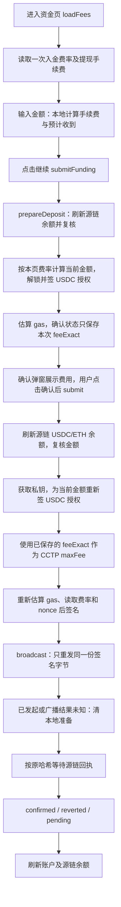

# perps-funding 页面行为与证据

更新日期：2026-10-22。实现基线：`f60a59b4` 及当前工作区。原始整理日期为 2026-09-23；协议核对和历史测试记录保留各自日期，当前实现边界见第 7.4 节。

文档入口：[Perps 功能地图与共享术语][feature-map]。2026-09-24 归并文档；协议来源的核对日期与结论、测试执行记录、待执行验收分别见第 7 节。

本页处理同一钱包地址的 USDC 入金和提现。入金由用户在 Arbitrum 上发起 CCTP 交易，提现由 Hyperliquid 接受签名操作后继续跨链。入金分为“继续准备 → 确认入金”，提现仍在资金页直接提交；签名、费用、等待结果和刷新方式不同；“已发起”“源链确认”和“最终到账”不能互相替代。

| 要理解的问题 | 需要拿到的证据 | 本文对应内容 |
| --- | --- | --- |
| 用户做了什么，预期结果是什么？ | 入口页面、操作步骤、验收条件 | 第 1 节：入口、入金与提现行为 |
| 数据如何流动？ | 从输入到请求，再到页面更新的调用链 | 第 2 节：读取、授权、广播、提现请求 |
| 核心规则是什么？ | 数量、价格、杠杆、保证金、手续费的计算及单位 | 第 3 节：余额、精度、下限、费用和到账估算 |
| 状态如何变化？ | 等待签名、已提交、成功、失败、取消等状态 | 第 4 节：准备、提交、发送、结果未知 |
| 异常怎么处理？ | 拒签、超时、断网、余额不足、重复点击 | 第 5 节：异常分类及处理边界 |
| UI 与真实结果如何保持一致？ | 请求响应、订阅、轮询、刷新和重连逻辑 | 第 6 节：账户订阅、源链轮询、费用复用及回收 |
| 正确性怎么证明？ | 协议文档、测试、可复现操作，而非仅靠代码解释 | 第 7 节：协议依据、测试结果、验收及缺口 |

## 1. 用户做了什么，预期结果是什么？

从永续首页进入 `/popup/perps/funding?tab=deposit` 或 `?tab=withdraw`；没有参数或参数不是 withdraw 时默认为入金。只读取路由初始参数。Perps 父路由检查钱包和 NeoX 链类型，funding 子路由再次运行 `PerpsFundingGuard`，避免区段内部切页绕过链类型检查。

| 操作 | 当前行为及验收条件 |
| --- | --- |
| 打开资金页 | `ngOnInit()` 调用 `loadFees()`，并行读取入金费率和提现手续费，各读取一次；两个页签共用这份页面费用快照 |
| 打开入金 | 显示所配置 Arbitrum 网络的原生 USDC 余额、25%/50%/MAX、手续费、预计收到及资金转移方向；准备完成后的确认弹窗显示 ETH 网络费 |
| 打开提现 | 显示按账户模式计算的可提 USDC、页面读取的手续费及预计收到；stale 时显示非实时提示 |
| 输入金额 | 十进制文本，最多 6 位小数；超出部分当场截断并回填。手续费和预计收到用已读取的费率本地计算，不清空已知费用，也不重新询价 |
| 使用百分比/MAX | 基于当前方向的可用源余额，向下取到 6 位小数；未知余额时不能使用。预设不是随每次余额更新自动跟随的订阅 |
| 入金点击继续 | 刷新 USDC/ETH，复核余额后用本页费率计算手续费，解锁并签 USDC 授权，再估算完整调用的 gas；不广播源链交易 |
| 入金准备完成 | 打开确认弹窗，显示金额、USDC 手续费、ETH 网络费、预计到账；等待用户再次确认。取消不发送交易，重新继续会生成新授权 |
| 点击提现 | 使用进入页面时读取的手续费和最低额，直接进入提交；资金页显示目的网络、手续费及预计收到，不单列本人收款地址 |
| 提交检查 | 提现刷新账户，入金刷新源链 USDC/ETH；复核余额并获取私钥，入金重新签 USDC 授权后发送。两个方向均复用页面通道费；入金发送时重新估算 gas、读取费率和 pending nonce |
| 入金广播成功 | 提示已发起、清金额及预设、丢弃本地授权，页面留在原处；后台 Promise 继续等待该源链哈希的回执 |
| 源链回执成功 | 刷新账户及源链余额，不显示“HyperCore 已到账”；失败回执提示已回滚，等待无定论提示仍在处理中 |
| 提现接口接受 | 提示已提交、清金额及预设、刷新账户，仍留在本页；没有目的链到账回执追踪 |
| 离页/切页签 | 使旧准备失效并清本地入金授权；切页签还清金额及预设，但不重读手续费。准备和提交期间锁定输入及预设，submitting 时禁止切页签；返回按钮仍可离开 |
| 重试 | 余额未知或当前方向费用读取失败时显示重试；刷新账户和源链余额，只补读失败的费用，已成功读取的费用不重复请求 |

本页没有地址编辑、资产/网络选择、杠杆或保证金设置，也没有交易进度列表、哈希链接、手动查询到账或撤销已广播交易入口。两个方向统一显示“手续费”，入金不显示费用 tip；入金确认弹窗不再单列网络或显示 CCTP 合约说明，提现没有额外确认弹窗。

证据：[组件][component]、[模板][html]、[首页导航][tab]、[Perps 路由][route]、[父路由][popup-route]、[守卫][guard]、[组件测试][component-test]。

### 1.1 网络与资产身份

| 配置 | 主网 | 测试网 |
| --- | --- | --- |
| 源/目的 EVM 网络 | Arbitrum，chainId=42161 | Arbitrum Sepolia，chainId=421614 |
| 转移币种 / gas 币种 | 原生 Circle USDC / ETH | Circle 测试 USDC / ETH |
| USDC 小数位 | 6 | 6 |
| Arbitrum CCTP domain | 3 | 3 |
| HyperEVM chainId / CCTP domain | 999 / 19 | 998 / 19 |
| 入金 HyperCore destinationDex | 0，标准永续余额入口 | 0，标准永续余额入口 |

`resolvePerpsTestnet()` 仅在非 production 且 perpsNetwork=testnet 时使用测试网；生产构建固定走主网。开发网络以仓库 `src/environments/environment.ts` 的实际值为准（2026-09-24 核对为 testnet）。选择 NeoX 测试网络本身不会改变这里的 Hyperliquid/CCTP 网络。

具体 USDC、CctpExtension、CctpForwarder、CoreDepositWallet 和 RPC 地址以 [配置常量][model] 为准。当前走用户自行广播的 CctpExtension，不是另一个需要 relayer 的 CctpExtensionV2；部署角色及地址可与 [Circle 地址表][p-addresses] 核对。

<a id="funding-decisions"></a>

### 1.2 资金路径的选择与理由

| 选择 | 理由与边界 |
| --- | --- |
| 只走 Arbitrum 原生 USDC 的 CCTP 路径 | 入金和提现不保留 Bridge2、`withdraw3` 或多链回退，避免维护多套费用、签名和到账语义。代价是该通道故障时客户端没有备用路径；失败或未知结果按原路径呈现，不静默切换通道 |
| 入金用 EIP-3009 授权和 CctpExtension | 用户先签 USDC 授权，再广播一笔源链交易，由合约完成收款与 burn；不拆成单独 approve、burn 两笔交易，也不引入 NeoLine relayer。固定合约与目标参数的身份见第 1.1、3.4 节 |
| 提款额度与 sourceDex 按同一账户模式口径确定 | `sendToEvmWithData` 的签名 payload 明确包含资金来源：标准账户用 `''`，统一/组合保证金的 USDC 路径用 `spot`。不能照搬其他提现接口的余额策略，或省略这个分支让服务端猜测；模式未知时不能确定可提来源 |

这些选择由[资金组件][component]、[入金链服务][deposit-chain]和[提现写服务][exchange]落实。它们不证明每次提交都取得最新账户模式；缓存与异步变化的限制仍见第 6、7.4 节。目标链异常后 HyperCore 扣款是否恢复仍须测试网证据，不能据“目标链回滚”直接显示“已退款”。

## 2. 数据如何流动？

### 2.1 页面事实来源

| 事实 | 调用链 | 更新方式 |
| --- | --- | --- |
| 钱包/地址 | `Store.select('account')` → 首个账户地址 | 地址或资金配置变化时重订账户并重启余额轮询 |
| HyperCore 账户 | `watchAccount(address)`，默认 dex='' → `getAccount()` | 首次 REST，后续 clearinghouseState 与 spotState；不读取首页的跨 DEX 聚合账户 |
| 账户模式 | `/info userAbstraction` | 读取服务缓存 30 分钟；force 刷新余额不等于必定重取账户模式 |
| 源链 USDC | `tokenBalanceExact(config,address)` → USDC.balanceOf | 进入页面立即读取，此后每 15 秒；提交前、手动重试及入金回执后另读 |
| 源链 ETH | `nativeBalanceExact(config,address)` → getBalance | 同一次余额流程在 USDC 请求结束后读取；两种余额失败分别记 null |
| 入金手续费 | `loadFees()` → `depositFeeRate()` | 进入页面读取并保存 Fast 档协议费基点和固定转发费；改金额、比例/MAX、切页签、准备及发送均在本地复用，失败时才手动补读 |
| 入金网络费 | `authorizeDeposit()` → `depositFeeExact()` | 有效 USDC 授权生成后估算真实调用，只返回以 ETH 计的费用数字；确认期间每 30 秒更新展示，发送时重新估算 gas 和读取费率 |
| 提现手续费 | `loadFees()` → `withdrawQuote()` → HyperEVM 合约只读调用 | 进入资金页读取并保存 `withdrawQuote`；改金额、切页签及提交不再询价，失败时才手动补读 |
| 连接状态 | `channel.watchConnectionState()` | 只有提现页显示 stale 提示；连接正常不等于余额或报价一定最新 |

HyperCore 标准账户快照包含 clearinghouseState、spotClearinghouseState 与账户模式；统一/组合保证金账户依赖现货 USDC。读取失败与正常空账户分开处理。

`loadFees()` 在费用请求仍在途或两侧费用均已成功读取时直接返回；重试只请求缺失的一侧。`destroyed` 和配置引用检查使销毁后的旧费用结果失效。费用缓存属于当前组件实例，不是服务级永久缓存；重新进入页面会重新读取。

证据：[组件][component]、[账户服务][account-service]、[账户解析][account-model]、[读取服务][hyperliquid]、[链服务][deposit-chain]、[报价服务][fee-service]。

### 2.2 入金：准备 → 复核 → 广播 → 查源链回执



准备和发送以 `submissionSeq`、钱包引用、配置、地址、页签、金额和组件生命周期隔离旧请求。`confirming` 表示入金确认弹窗已打开，`canConfirm` 检查当前是否可以提交；取消、改金额、换钱包、切页签或离页都会丢弃旧准备。确认状态只保存通道手续费，估算授权由 gas 定时器闭包持有，不保存待签交易或私钥字段。发送前重新读取 USDC/ETH 并按最近估算校验余额，再生成新的 USDC 授权。

源链服务先生成并签好完整交易，再交给 `rpc.broadcast()`。重试/轮换 RPC 时提交的是同一份原始字节，哈希由本地 keccak256 算出。即使广播答复丢失，仍可按原哈希查询，不创建另一笔入金。

入金源链交易的接收合约是 Arbitrum CctpExtension。跨链参数中的 mintRecipient 和 destinationCaller 都是配对网络的 HyperEVM CctpForwarder；最终 HyperCore 用户地址来自授权签名者，通过 hookData 携带。三种地址承担不同角色。

证据：[组件 `prepareDeposit/submit/trackDeposit`][component]、[链服务 `sendDeposit`][deposit-chain]、[RPC 广播][rpc]；协议路径见 [Circle 入金指南][p-deposit]。

### 2.3 提现：页面费用 → 余额复核 → 签名的交易所操作

进入页面时 `loadFees()` 取得 `withdrawQuote` → 点击 `submitFunding()` → 直接 `submit()` → `refreshAccount(address)` → 检查余额并确定 `fromSpot` → `getPassword/getPrivateKey` → `writes.withdraw(privateKey,address,amount,{fromSpot})` → 签 `sendToEvmWithData` → POST `/exchange`。金额下限和预计收到使用本页保存的手续费，提交中不再调用 `withdrawQuote()`。

关键 payload 为 `token=USDC`、规范化金额文本、`sourceDex=''` 或 spot、`destinationRecipient=本人地址的小写形式`、`addressEncoding=hex`、`destinationChainId=3`、`gasLimit=200000`、`data=0x`、nonce，以及 Mainnet/Testnet 标识。这里 destinationChainId 是 CCTP domain，不是 42161/421614。data 为空启用默认转发路径。

这不是源链 EVM 转账，用户不在本页另签 HyperEVM 或目的链交易，也不先发 ERC-20 approve。提现签名不携带页面手续费作为不可变上限，页面也不在发送前重新询价；页面预计收到依据进入时的费用快照计算，实际扣费仍需关联账本及目的链结果。

收到可接受答复仅提示已提交并刷新 HyperCore 账户。当前没有把提现 nonce 与账本/目的链交易关联，也没有自动等待到账；另见 [历史页文档][history-doc] 的账本和 CCTP 证据边界。

证据：[组件 `loadFees/submitFunding/submit`][component]、[写服务 `withdraw`][exchange]、[签名 payload][signing]；协议路径见 [Circle 提现指南][p-withdraw]。

## 3. 核心规则是什么？

### 3.1 金额、精度、可提余额及下限

约定 A 为输入 USDC，总费用报价为 F。数量均为转移币数，不使用市价、杠杆或订单保证金公式。

| 规则 | 当前计算及单位 |
| --- | --- |
| 输入/签名金额 | 保持十进制文本，BigNumber 规范化；UI 两个方向均最多 6 位小数；源链 parseUnits(A,6) 转整数，不经过 Number |
| 入金上限 | 当前配置源链的 USDC balanceOf，未知为 null；不读取 NeoX 当前网络的 USDC 余额 |
| 标准及非 unified 模式提现 | 标准 DEX 的 withdrawableExact；不加上其他 HIP-3 DEX 可提额，也不加独立现货余额 |
| unifiedAccount / portfolioMargin 提现 | `max(spotUsdcExact - spotUsdcHoldExact, 0)`，从 spot 扣款；本页只处理 USDC，不折算 HYPE 等其他抵押品 |
| dexAbstraction | 协议已停用，API 仍保留返回值；本地兼容标准 DEX withdrawable/sourceDex='' 路径，不切换模式 |
| unknown 模式 | 可提余额为 null，阻止提现；入金使用独立源链余额，不单因模式 unknown 被禁用，但仍要求账户数据存在 |
| 百分比 | `floor_6(当前上限×25%或50%)`；MAX=`floor_6(当前上限)`，不预扣通道费，费用从输入总额中扣 |
| 入金下限 | A≥5 USDC，明确是产品下限，不是当前 CCTP 的固定协议门槛 |
| 提现下限 | A≥2F，且 A>0；这是本地产品缓冲，不是协议规定的固定最低提现额；未取到报价时不能判断下限，也不能提交 |
| 预计收到 | `max(A-F,0)`；资金页使用进入时读取的费率或手续费。未知费用不编成零；ETH 网络费不从 USDC 预计收到中扣 |
| 显示精度 | 输入最多 6 位；金额摘要通常显示 2 位，余额向下显示 2 位，资金页 ETH 网络费向下显示 8 位；签名仍用精确原值 |

例如 unified 账户 spot total=12.3456789、hold=2，则本地计算的上限为 10.3456789，MAX 为 10.345678；若 F=0.2，预计收到 10.145678 USDC。费用翻倍下限为 0.4，不意味着所有网络始终收 0.2。

上述 `total-hold` 是当前实现使用的本地 USDC 上限，并非已证明适用于所有账户的最大可提额。2026-09-28 重新核对 [Margining][p-margining]、[Portfolio margin][p-portfolio] 和 [Circle 提现指南][p-withdraw]：提现受转出保证金限制，组合保证金还涉及多资产与借款；这些正文未给出 `total-hold` 在所有场景都等于最大可提额的保证。真实账户边界按 F17 验证，尚无依据替换为另一条通用公式。

提交前余额低于输入时，手动金额保持原值并停止；若先前选的是 MAX，更新为新的向下量化余额后停止，等待再次操作。余额上涨不自动增加用户已经输入的金额，25%/50% 也不在此重新计算。

证据：[组件余额、预设和校验][component]、[格式化工具][util]、[账户模式解析][account-model]、[常量][model]；模式区别见 [Account abstraction modes][p-modes]。

### 3.2 入金费用

`depositFeeRate()` 在进入页面时读取当前网络 Circle `/v2/burn/USDC/fees/3/19?forward=true&hyperCoreDeposit=true`，只接受 finalityThreshold=1000 的 Fast 档，返回协议费基点和以 USDC 计的固定转发费，页面按金额本地计算并直接返回 `feeExact` 字符串；没有独立的 `maxFeeExact` 字段。

| 组成 | 当前计算 |
| --- | --- |
| CCTP 协议费 | `ceil_6(A × minimumFee / 10000)`；minimumFee 单位为 bp |
| CCTP 转发费 | `forwardFee.high / 10^6` USDC；字段缺失/不可读就拒绝读取，不用历史常量兜底 |
| 手续费 feeExact | 协议费 + 转发费；用于页面显示、预计收到、准备时的 gas 估算及源链调用的 CCTP `maxFee` |
| 新账户费 | 不查询账户存在性或 `newCoreAccountFee()`，不叠加到报价及预计收到 |
| 网络费 networkFeeExact | `floor(estimateGas × 12/10) × (maxFeePerGas ?? gasPrice) / 10^18` ETH；与 USDC 手续费分开 |

算例：A=10、minimumFee=0、forwardFee.high=200000 时，手续费为 0.2、预计收到为 9.8 USDC；修改金额不会改变这份固定费。若 minimumFee=1.4 bp，同样金额的手续费为 0.2014、预计收到为 9.7986 USDC。两种情况均复用已读取的费率本地计算，不能把 0.2 写死。

确认状态只保存本次 `feeExact` 字符串；`networkFeeExact` 单独保存费用数字供弹窗展示，估算授权由定时器闭包持有，不保存待签交易。发送时重新授权，仍使用本页的通道手续费，但重新估算 gas 和读取链上费率。客户端不再展示新账户费，不等于对实际账本是否存在激活费作出判断；真实扣费仍按 F16/H14 验证。

网络费依据真实 batchDepositForBurnWithAuth 调用估算并加 20% gas 余量。depositFeeExact 只返回以 ETH 计的费用数字；确认期间每 30 秒复用估算授权重新读取该数字，刷新期间禁用确认且不重叠请求。取消、切页签、换钱包、离页或开始提交时停止定时器，在途旧响应按 submissionSeq 丢弃；刷新失败结束本次确认，可重新准备。发送时生成新授权，再构造交易、估算 gas 并读取费率和 pending nonce，不额外检查授权有效期。ETH 网络费预算不是最终花费。共享 RPC 保留 ethers 默认短时缓存。

确认弹窗的网络费数值在重新估算开始时循环淡闪，每轮 600 毫秒；刷新成功写回费用并复位 `preparingDeposit` 后立即停止。动画直接绑定现有计算状态，没有单独的动画状态或定时器；开启减少动态效果偏好时不播放动画。刷新失败沿用关闭本次确认的处理。

`gasShortfall` 仅在 ETH 余额和网络费均已知且余额小于费用时为 true。ETH 余额未知不被当成零，准备和确认发送时均停止并提示刷新失败。入金手续费大于金额时，预计收到降为零，但本地闸门仍没有额外的 `A>feeExact` 校验，属于 F4 已知缺口。

证据：[报价服务][fee-service]、[授权及 gas 估算][deposit-chain]、[组件][component]、[报价测试][fee-test]。

### 3.3 提现手续费与页面费用复用

提现调用 HyperEVM CoreDepositWallet 的 `calculateCrossChainWithdrawalFee(true, 3)`，按 6 位小数解码 USDC；不直接读可能未覆写的 cctpForwardFees 映射。结果只含 `feeExact`，页面最低额为 `2 × feeExact`。

两侧费用在进入资金页时各读取一次；改金额、比例/MAX、切换页签、签名准备和发送都不重新询价。已成功的费用不会被 `reload()` 重读；读取失败时手动重试只补读缺失费用，重新进入页面则重新读取两侧费用。

当前没有 `prepareWithdraw()`、`withdrawConfirmedQuote`、费用变化比较或涨价后再次点击的步骤，也没有报价 TTL。手续费与预计收到直接展示在表单，两侧统一使用“手续费”标签，入金没有费用提示图标或说明。

预计收到只减去本服务读取的通道手续费；手续费快照不是实际扣费回执，提现签名也未将其作为固定费用上限。最终到账应结合账本与目的链回执确认。[Circle 提现费用说明][p-withdraw]

证据：[报价服务][fee-service]、[组件费用读取及计算][component]、[历史页回执匹配规则][history-doc]。

### 3.4 授权、目标与重试中的不变量

| 项目 | 当前规则 |
| --- | --- |
| USDC 授权域 | 从源 USDC 合约读取 name/version，配源链 chainId 和该 USDC verifyingContract |
| 授权内容 | ReceiveWithAuthorization：from=私钥地址、to=CctpExtension、value=A 的最小单位；validAfter=0、validBefore=当前秒+1800，随机 32 字节 nonce |
| 授权生命周期 | 确认期间的授权仅用于估算，最终发送重新生成授权及有效期。授权仅在内存；取消、切页签、销毁或一次发送尝试结束后丢弃。删除本地对象不等于链上撤销授权，已签许可在协议有效期内仍有意义 |
| 入金目标 | domain=19，mintRecipient/destinationCaller 均为配对 HyperEVM forwarder 的 bytes32；配置没有配对则拒绝，不能猜主网/测试网 |
| hookData | 24 字节标记、4 字节版本 0、4 字节内容长度 24、20 字节授权 from、4 字节 destinationDex=0 |
| 提现签名 | 用户签名 EIP-712 HyperliquidSignTransaction；本地 signatureChainId=421614，另以 hyperliquidChain 区分端点网络，不能用该签名域数字判断钱到哪条链 |
| 提现 nonce | 当前服务实例按签名者分配 `max(Date.now(),last+1)`；确定的 nonce 业务拒绝最多重新签名一次，传输失败不自动重签 |
| 入金广播重试 | 对固定 signedTransaction 重发，始终相同哈希；already known 等视为已知同一交易。曾经出现不确定尝试后，后续 nonce 拒绝不能覆盖原未知状态 |

入金授权不包含 CCTP maxFee，也不包含最终 EVM gas 费用；提现签名不包含页面的 feeExact。用户审核报价与协议真正锁定字段应分开核对。

证据：[链服务与 hook 编码][deposit-chain]、[签名模块][signing]、[写服务][exchange]、[nonce][nonce]、[RPC][rpc]、[Circle 入金指南][p-deposit]。

## 4. 状态如何变化？

页面由 accountLoading/accountLoadError、feesLoading、preparingDeposit、submitting、费用字段及 submissionSeq 驱动。`confirming` 根据 depositConfirmedFeeExact 是否为 null 计算，`canConfirm` 判断当前是否可提交；没有统一持久化的资金状态机。

| 状态/事件 | 转移及可观察结果 |
| --- | --- |
| 初始化读取 | 并行读取两侧费用及账户/源余额；当前方向余额或费用未知时不可提交。未知费用/预计收到显示“未知”，未知余额使用缺失占位 |
| 编辑草案 | 入金校验通过可点击继续，提现可直接提交；手动改金额清预设、刷新警告和旧入金准备，用缓存费率即时计算，不清空已知费用 |
| 入金准备中 | confirming=false、preparingDeposit=true；本地计算手续费、取私钥、签授权并估 gas；金额、预设和提交按钮禁用 |
| 入金等待确认 | confirming=true；锁定金额及预设，弹窗展示预算，每 30 秒重新估算 gas；刷新期间 preparingDeposit=true、网络费循环淡闪且确认按钮禁用，成功后更新预算并停止动画 |
| 提现提交 | 使用已读取的 withdrawQuote 直接进入 submit；没有确认弹窗或另一次费用请求 |
| 入金 gas 不足 | 准备结束停止提交，清本次授权/报价，但保留页面费率与网络费不足原因；不是已广播失败 |
| 离页/切页签 | confirming=false，清入金准备并使旧准备失效；销毁还使在途费用响应失效，不发送撤销授权交易 |
| 提交中 | submitting=true，入金弹窗保留并禁用确认/取消；刷新余额、解锁和发送共用此标记，金额输入禁用；不重新读取手续费 |
| 本页识别到余额刷新失败 | submitting=false、refreshFailed=true，不继续发送；源余额未知时清入金确认。共享服务保留 stale 旧账户时不能识别该失败，见 F7 |
| 余额降到输入以下 | submitting=false，balanceMovedUnderInput=true；手动金额不缩减，MAX 可下调后等待再次操作 |
| 入金已广播 | 清授权、金额和预设，submitting=false；提示已发起，然后按哈希等回执。等待期间可以发起另一笔新的意图 |
| 入金广播答复不确定 | 提示状态未知，清表单及授权，仍按原哈希等回执；组件不会自动重新准备或发送 |
| 源链 confirmed | 回执 status=1，刷新余额；没有把它直接标成 HyperCore 入账 |
| 源链 reverted | 回执非成功，提示已回滚并刷新；本地不继续等待这次入金的 HyperCore 到账 |
| 源链 pending | 没回执或链读取无定论，提示仍在处理中并刷新；页面没有后续持久追踪记录 |
| 提现已提交 | await firstValueFrom 返回成功后清金额/预设、解除 submitting，提示已提交并刷新账户；不是目的链已到账 |
| 提现结果未知 | 提示 perpsWithdrawStatusUnknown、解除 submitting、保留金额并刷新账户；没有持续关闭提交闸门或自动查询 nonce |
| 确定失败 | 准备或发送异常提示 txFailed，解除 submitting；余额刷新失败使用页面刷新失败提示 |

`disabledReason` 按签名方式、账户错误、余额/报价未知、刷新警告、金额/精度/余额/下限、gas 不足的顺序显示一个原因。refreshFailed 和 balanceMovedUnderInput 是提示标记，不直接纳入 canSubmit；条件恢复后用户仍可再次发起检查。

证据：[组件状态与 canSubmit/canConfirm][component]、[源链结果][deposit-chain]、[模板][html]、[组件测试][component-test]。

## 5. 异常怎么处理？

| 异常 | 当前处理 | 边界/需要保留的证据 |
| --- | --- | --- |
| Neo2/Neo3 或链类型读失败 | 守卫回钱包首页 | 不把非 EVM 地址用于资金操作 |
| Ledger/二维码钱包 | signingUnavailable 在打开准备前阻止，并显示原因 | 两条路径都需要可导出的私钥，当前未支持这些签名方式 |
| 余额未知 | 对应值为 null；无法设置该方向预设或提交，可重试 | ETH 未知与 USDC 未知的闸门不同：ETH 未知不等于 gasShortfall |
| 用户取消解锁/私钥读取失败 | 准备和 submit 外层均提示 txFailed；submit 失败清入金确认 | 没有独立用户拒签枚举；txFailed 不只表示已广播交易在链上失败 |
| 可用 USDC 降低 | 刷新后停止，标余额变化，必要时下调 MAX | 不在每个后续 await 后重做完整余额/账户身份检查 |
| ETH 不足 | 准备时已知不足则停止提交，显示所配置链的 ETH 不足 | 页面按最近一次费用估算校验 ETH；发送时会重新估算，费率或余额变化仍可能使广播被拒绝 |
| 报价缺 Fast 档/非法字段 | 报价服务抛错，不假设为免费 | 入金报价验证有限值，未完整校验负费率等所有异常数值；需用异常响应验收 |
| 入金/提现费用读取失败 | 对应费用为 null，不能提交，显示重试；手动重试只补读失败费用 | 不用零费用或历史常量替代失败；费用已成功读取后，提交阶段不再请求 |
| RPC/报价 HTTP 超时、0、502/503/504 | 10 秒单请求超时；最多重试 4 次，250/500/1000/2000ms 退避；RPC 再轮换端点 | 每端点最多 5 次尝试；不是整个页面操作最多 10 秒 |
| 明确 4xx、带答复的 500、业务 revert、浏览器离线 | 不按临时传输错误重试，分类为 rejected | 当前重试分类是客户端策略；不能推出链上资金一定如何回补 |
| 入金广播丢回复 | 固定原交易重发；无可判定结果抛带原 hash 的未知异常，组件只查原哈希 | 不新签第二次入金；INSUFFICIENT_FUNDS/REPLACEMENT_UNDERPRICED 且无先前不确定尝试时保留确定拒绝 |
| 源链回执久未确认 | waitForTransaction(hash,1,90000)，无回执/PerpsChainError 记 pending | 外层仍有 RPC 重试/端点轮换，90 秒不构成整段追踪的严格总时限 |
| 提现 nonce 明确被拒 | 至多分配新 nonce 重签一次 | 只针对明确业务拒绝，不对丢回复、0/5xx 自动重发 |
| 提现响应丢失/不可解码 | unknown 提示并刷新；4xx/明确拒绝提示失败 | 没有提现结果恢复状态机；未知后表单仍可再次操作，不能宣称已实现跨窗口或未知期间防重 |
| 重复点击 | fundingBusy 覆盖 confirming、preparingDeposit 和 submitting，准备及发送期间拒绝再次提交、锁定金额和预设 | 页签仅在 submitting 时禁止切换；准备阶段切换会使旧操作失效 |
| 授权超期 | 最终发送重新授权；确认期间的旧授权超期仍可能导致费用估算失败 | 本页没有 30 分钟到期倒计时或自动重新准备；丢弃授权不等于链上已消耗 |
| 离开/切地址 | 读取有部分地址检查，入金准备有序号防过期 | 提交和已交给链服务的调用不具备完整取消能力，见第 7.4 节 |

POST `/exchange` 没有显式 timeout。通用响应解析拒绝顶层 err 和逐项 error，但没有专门证明目的链结果；顶层 ok 的结构校验也不等于最终提现成功。

证据：[组件][component]、[守卫][guard]、[RPC 策略][rpc]、[报价服务][fee-service]、[写服务][exchange]、[失败分类][failure]。

## 6. UI 与真实结果如何保持一致？

| 机制 | 当前实现及边界 |
| --- | --- |
| 账户快照与 WS | 标准 DEX 账户使用共享数据集，在 REST 在途时缓冲 clearinghouse/spot 帧，再回放到快照；相同地址的并发刷新共用在途请求 |
| 账户失败重试 | 有观察者时按指数退避重读；普通失败从 1 秒、429 从 10 秒起，上限 60 秒；不是组件自行轮询 HyperCore 余额 |
| WS 重连 | 通道恢复订阅，账户数据集补快照；30 秒 ping/10 秒 pong 超时，重连延迟 1、2、4…秒，上限 30 秒 |
| 源链轮询 | 两个页签都维持每 15 秒 USDC/ETH 读取，submitting 时跳过新一轮；已在途轮询不取消，同地址并发返回没有请求代次排序 |
| 提交前刷新 | 提现调 refreshAccount，入金读源余额；无法取得所需余额时停止。共享账户状态不含 refreshFailed，刷新失败但保留旧 account 时仍可能提现，是 F7 已知缺口 |
| 模式缓存 | refreshAccount(force=true) 刷清算所/现货，但 userAbstraction 仍可能命中 30 分钟缓存；发送 sourceDex 是否跟上外部模式切换需联调 |
| 费用复用 | 进入页面并行读取两侧费用，页面内复用；改金额只本地计算。准备好的入金报价与授权金额配对，发送不重读费用；费用展示不是实际回执 |
| 写后刷新 | 提现接受/未知时刷新账户；入金回执结算后刷新账户及源余额；WS 和 15 秒轮询可继续反映后续变化 |
| 成功判定 | 当前本页只确认源链交易结果或交易所接受，不按余额差额匹配某笔跨链款项，也不追踪 attestation、forwarder 或目的链 mint |
| 销毁 | 退订钱包、连接和账户数据流，清余额定时器及入金准备；destroyed 和配置检查使旧费用响应失效。未取消底层 Promise、已发出的写请求或源链回执等待 |

入金 trackDeposit 完成后只检查配置和地址是否仍匹配，没有额外 destroyed 标记；离开但地址未变时仍可能继续提示和刷新。销毁后旧费用响应已有 destroyed 检查；已在途余额读取、写请求和源链回执等待仍未全部中止。页面离开不等于撤回已广播资金移动。

证据：[组件][component]、[账户状态服务][account-service]、[共享数据集][dataset]、[读取服务][hyperliquid]、[数据通道][channel]、[写操作架构约定][write-contract]。

## 7. 正确性怎么证明？

### 7.1 协议及外部证据

以下官方资料于 2026-09-23 在线核对；未发起真实交易，也未读取任何私钥。

| 资料 | 能证明的范围 |
| --- | --- |
| [Circle Arbitrum → HyperCore][p-deposit] | CctpExtension、ReceiveWithAuthorization、询价路由、forwarder 与 hook 参数、源链 gas 估算流程 |
| [Circle HyperCore → EVM][p-withdraw] | sendToEvmWithData、sourceDex、CCTP domain、空 data 的自动转发及扣款到铸币的多个阶段 |
| [Circle 合约地址][p-addresses] | 主网/测试网 CctpExtension、CctpForwarder、CoreDepositWallet 身份；与 V2 sponsored 路径区分 |
| [CoreDepositWallet 接口][p-core-wallet] | HyperCore 入账入口和 destinationDex 语义；当前该说明页未完整列出本地所读费用 getter，不能据此宣称已核验其实时值 |
| [Hyperliquid 账户模式][p-modes] | 标准账户与统一/组合保证金账户的余额来源差别；不把单 DEX 余额当聚合可提值 |
| [历史页 CCTP 证据边界][history-doc] | 说明代码如何关联提现 nonce、索引和目的链回执；仅覆盖匹配到的历史记录，不能证明未来实时费率或每笔提现到账 |

最小证明链：入金需授权域/金额、源链签名交易与成功回执、目标 mint/转发事件、HyperCore 对应账本；提现需签名 action、交易所答复、源账户扣款账本、目的链 mint 和接收余额。单元测试通过、源链成功或余额增长中的任意一个都不能单独证明整条跨链路径正确。

### 7.2 已有测试与本次结果

| 测试 | 主要覆盖 |
| --- | --- |
| [资金组件测试][component-test] | 标准/统一/组合保证金余额、6 位输入及精确 MAX、提交刷新、入口费用读取与失败补读、gas 不足、授权生命周期、未知广播原哈希追踪、源链三类结果、入金确认弹窗、取消、失败重试及重复点击 |
| [守卫测试][guard-test] | NeoX 放行、其他链及读取失败重定向 |
| [源链服务测试][deposit-test] | EIP-3009 域与金额、hook 布局、配对 forwarder、maxFee、20% gas、固定交易字节广播及源链结果 |
| [报价测试][fee-test] | Fast 档、不同网络 API、协议费基点与 USDC 转发费、不查询或叠加新账户费、提现合约报价及两倍下限 |
| [RPC 测试][rpc-test] | 传输/拒绝/离线分类、同字节广播、already known、哈希保留及先未知后拒绝 |
| [写服务测试][exchange-test]、[签名测试][signing-test]、[nonce 测试][nonce-test] | 提现扣款来源、payload/签名恢复、明确拒绝与未知响应、实例内 nonce 分配 |
| [账户服务测试][account-service-test]、[账户解析测试][account-model-test]、[数据集测试][dataset-test]、[读取服务测试][hyperliquid-test] | 账户模式、精确余额、快照/WS 仲裁、重连及失败保留规则 |
| [格式化测试][util-test] | 金额/余额展示与协议精度边界 |

在仓库根目录执行：

```bash
nvm use
npm run lint
npm run test:ci -- \
  --include='src/app/popup/perps/perps-funding/*.spec.ts' \
  --include='src/app/core/services/perps/perps-deposit-chain.spec.ts' \
  --include='src/app/core/services/perps/perps-fee-quote.spec.ts' \
  --include='src/app/core/services/perps/perps-rpc.spec.ts' \
  --include='src/app/core/services/perps/perps-exchange-write.service.spec.ts' \
  --include='src/app/core/services/perps/hyperliquid-signing.spec.ts' \
  --include='src/app/core/services/perps/hyperliquid.service.spec.ts' \
  --include='src/app/core/services/perps/perps-account-state*.spec.ts' \
  --include='src/app/core/services/perps/perps-dataset.spec.ts' \
  --include='src/app/core/services/perps/perps-nonce.spec.ts' \
  --include='src/app/popup/perps/perps.util.spec.ts' \
  --reporters=dots
```

此前文档审计环境：Node `16.20.1`、npm `8.19.4`、ChromeHeadless `154`。当时定向测试 **284 项通过**，包含共享服务的其他业务用例；lint 未通过（当时模板第 49 行 `withdrawableExact != null`），未执行全量测试、生产构建或真实跨链交易。该记录保留为历史结果；当前模板已使用 `!== null`。

2026-09-30 根据下方方案新增 **36 条资金浏览器测试、2 条主网服务测试**。全量 E2E 执行 80 条：**76 条正常通过、4 条已知缺口按预期失败**；全量单元测试 **1114 条通过**，lint、E2E 类型检查通过。逐项证据、已知失败和运行方式见[资金验收映射][funding-e2e]。网络替身不替代真实链路证据。

2026-10-13 最近实现验证：全量单元测试 **1132 项通过**，lint、应用及 E2E TypeScript 检查通过。资金浏览器回归先执行 44 项，随后复验 3 项调整后的用例；最终覆盖 **42 项正常通过、2 项原有缺口按预期失败**（F4 入金费用吞掉金额、F7 stale 保留旧账户）。没有执行真实跨链交易。此次 README 更新只核对文档与代码，不重新运行上述测试。

2026-10-16 当时的范围清理验证：lint、单元测试及 E2E TypeScript 检查通过，全量单元测试 **1126 项通过**。资金浏览器测试执行 **46 项**：**45 项正常通过、1 项 F4 费用吞掉金额按预期失败**；当时 F7 刷新失败保留旧账户时仍阻止提现。未执行生产构建或真实跨链交易。

2026-10-22 入金网络费接口只返回费用数字，确认期间每 30 秒刷新展示；发送时重新估算 gas、读取费率和 nonce。当时 lint、单元测试及 E2E TypeScript 检查通过，全量单元测试 **1126 项通过**。资金浏览器回归覆盖 **46 项**，最终 **45 项正常通过、1 项 F4 按预期失败**；其中 3 项涉及 ethers 默认 250ms 缓存时序的用例调整后定向复验通过。随后移除本地授权有效期检查及其 2 条单元用例。未新增测试文件。

2026-10-22 本次精简：撤回共享 refreshFailed、恢复链服务及其测试，费用计算直接返回字符串，确认状态只保存费用；发送前重新授权。lint、E2E TypeScript 检查及全量 **1121 项单元测试通过**；资金浏览器回归 **46 项**，其中 **44 项正常通过、F4/F7 两项已知缺口按预期失败**。未新增文件。

2026-10-22 gas 刷新动画调整为计算期间循环播放、成功更新后停止。调整代码时 lint、**63 项资金组件单元测试**及 **1 项 F6 浏览器回归**通过；本次文档校对未重新运行测试。

### 7.3 可复现验收方案

F1–F13 已按自动化方案扩展测试，当前资金浏览器测试保留 F4、F7 两条已知缺口的预期失败。费用读取时机以本页和当前测试代码为准；[验收映射][funding-e2e]中的早期执行数量是历史记录。各编号仍有边界，不能整体记为已验收。F14–F17 保留为真实测试网待验收项。

准备：使用测试网软件钱包及源链原生 USDC/ETH，记录代码版本、构建端点、账户模式、地址、合约配置和报价。用可控替身覆盖延迟/失败/费用变动；真实流程保留公开交易哈希、nonce、请求答复、账本和截图，不记录密码、私钥或可用授权签名。

| 编号 | 操作步骤 | 验收条件/需核对结果 |
| --- | --- | --- |
| F1 网络与入口 | 分别从首页进入存入/提现，用 Neo2/Neo3 访问；核对构建主网/测试网 | 页签正确，链守卫生效；源链、USDC、forwarder 和 Hyperliquid 网络配对，不受 NeoX 网络选择误导 |
| F2 账户模式 | 标准/统一/portfolioMargin/unknown 设置不同 perps、spot total、hold 和 HIP-3 余额 | 标准只读标准 DEX withdrawable；统一/PM 为 max(total-hold,0)；不合并其他币或池；unknown 不提现 |
| F3 精确金额 | 输入 7 位小数、设置小数尾数 MAX、25%/50%，并检查签名参数 | 输入截到 6 位；MAX/比例向下取，不经 Number 丢最小单位；摘要显示精度不改变提交值 |
| F4 入金费用 | 模拟 bp=0/1.4、转发费最小单位 200000；再缺 Fast 档或给非法费 | 只计算协议费及转发费，feeExact 同时用于显示和 CCTP maxFee；不查询新账户费；失败不回退免费；费用吞掉金额仍为已知缺口 |
| F5 入金授权和目标 | 点击存入并延迟授权/gas，解码签名及 calldata；离页再进入 | 授权金额/域/to/有效期正确；mintRecipient 与 caller 为配对 forwarder；hook 为本人和 dex=0；无独立 approve/提前广播 |
| F6 gas | 用精确相等、少一个最小单位及未知 ETH 余额；确认后再提高模拟 gas | 已知不足阻止；未知不被报零；确认期间每 30 秒更新 gas，重算开始时播放动画，成功更新后停止；弹窗只展示费用估算，开始发送后停止定时器并重新估算 gas，不要求签名预算与展示一致 |
| F7 刷新与 MAX | 提交准备期间减少余额，分别用手填和 MAX；使刷新失败或返回 stale 旧账户 | 手填不改、MAX 下调后停止；读取失败且没有可用账户时停止；stale 保留旧账户时仍可能提现，保留预期失败用例 |
| F8 页面费用复用 | 进入页面读取费用后修改金额、比例/MAX、切页签，再改变接口替身费率并提交；准备中离页重开 | 每侧成功费用仅请求一次；页面计算及发送使用入口费率，提交无二次询价/费用变化确认；旧入金准备不能发送 |
| F9 入金广播 | 模拟接受后丢响应、端点轮换、already known、后续 nonce 拒绝 | 各次广播字节/哈希相同；未知后查询原哈希，无第二笔入金；真实源链以 receipt.status 判成功 |
| F10 入金后续 | 给 confirmed、reverted、无回执；关闭再打开 | 提示区分正确；源链成功不宣称最终到账；记录页面关闭后没有持久恢复，另核对目标 mint/HyperCore 账本 |
| F11 提现 payload | 标准/统一账户分别提交提现，检查 action 与签名域 | sourceDex 为 ''/spot，目标本人、domain=3、data=0x；不是目的 EVM chainId；没有另签目的链交易 |
| F12 提现异常 | 明确 nonce 拒绝、余额拒绝、0/5xx、畸形响应及长时间无答复 | nonce 业务拒绝最多一次重签；其他确定拒绝与未知区分；未知不自动重发，但记录当前允许人工再次提交的范围 |
| F13 生命周期与串号 | 入页费用/源余额/解锁延迟时切钱包、切页签、离页或销毁，使旧费用响应后返回 | 费用响应与入金准备有代次保护，旧页面结果不影响新实例；准备完成时复核意图，submit 内后续 await 的钱包绑定仍需联调，不能概括为完整隔离 |
| F14 最终到账 | 测试网完整执行两方向，关联源链/交易所账本和目的链回执 | 按同一笔交易证据核对实际扣款、全部费用、接收地址与到账金额；余额变化本身不足以证明归因 |
| F15 提现不足额与资金回补 | 用测试网夹具覆盖提现额低于通道费、或目标链执行失败的场景，关联原签名 action、HyperCore 账本及目的链结果 | 区分发送前拒绝、源账户实际扣款、目标失败与后续回补；没有关联回补证据就保持结果未确认，不显示已退款；根据实测再评估两倍报价下限 |
| F16 激活费账本 | 在测试网首次资金路径中记录是否收取激活/新账户费用，保存实际 `delta.type`、金额字段、费用字段及对应操作 | 对照报价、扣款和到账，不把费用名相似当作同一笔扣费；若存在独立账本行，按[历史页 H14][history-doc]核对显示；未观察到记录不等于协议永不收费 |
| F17 实际可提限制 | 对标准、统一和组合保证金账户保存现货 total/hold、永续仓位、借款与风险状态，覆盖空仓、全仓/逐仓、冻结及借款场景；将本地 MAX 与可关联的实际提现答复对照 | 区分本地 USDC 上限与交易所认可的最大可提额；不得仅凭余额字段或单次成功就宣称所有账户可提限制均已验证 |

F15–F16 承接旧迁移方案中未完成的验收项，本次未执行。F15 的异常参数通过测试夹具构造，不要求产品 UI 绕过现有金额校验；在取得真实证据前不据此放宽下限。

### 7.4 实现边界与待补证据

1. **资金追踪能力有明确边界。** 本页未持久化公开追踪记录，未实现广播后追踪记录保存失败提示、无法唯一归因的入账标记或跨重启待入账列表。当前只有内存授权和一次源链回执等待；不能写成完整资金追踪系统。
2. **入金准备会先签授权。** 点击继续后先刷新余额，再签授权并估算；确认后再次刷新余额并重新授权，刷新失败不继续发送。授权签名本身不产生源链交易。
3. **钱包与生命周期隔离不完整。** 钱包、地址、配置、金额、页签变化及销毁会使本次准备失效，准备和发送以 submissionSeq 丢弃失效操作。确认状态只保存费用，最终发送重新授权。已经广播的调用不能因离页撤回，且不跨窗口协调。
4. **费用是页面快照。** loadFees 以 destroyed 和配置引用防止旧响应覆盖，成功费用在本页不再刷新，也不设 TTL；只有失败费用可手动补读。实际通道费变动不会触发涨价确认，页面估算不保证等于最终扣费。
5. **提交前刷新不一定代表取得新事实。** 数据集可能合并已有在途请求，断线读取失败可保留旧 account，本页不能识别这次失败并仍可能提现，这是 F7 已知缺口；账户模式还有独立缓存。
6. **估算与最低额仍需边界验收。** ETH 预算在确认期间每 30 秒更新，发送前复核余额；ETH 未知时停止，不额外做本地授权有效期检查。入金报价吞掉金额和报价异常值仍缺完整 UI 阻断。两倍提现下限只能作为产品缓冲，不能证明未来扣费上限或回滚退款。
7. **未知结果处理没有全局防重保证。** 提现 unknown 后解除 submitting 且保留金额，入金广播后也解除 submitting；当前只避免同一次发送自动生成另一笔意图，不跨窗口协调，不持久化，也不自动判断最终到账。
8. **本地测试不替代部署证据。** 本次未验证费用 getter 的实时值/所有异常数值、真实签名被服务端接受、目标链异常后资金回补、完整跨链到账或所有账户模式的真实可提限制。F1–F13 的本地证据与缺口见[验收映射][funding-e2e]；F14–F17 仍待真实测试网执行。

[component]: ./perps-funding.component.ts
[funding-e2e]: ../../../../../e2e/perps/funding-acceptance.md
[html]: ./perps-funding.component.html
[component-test]: ./perps-funding.component.spec.ts
[guard]: ./perps-funding.guard.ts
[guard-test]: ./perps-funding.guard.spec.ts
[tab]: ../perps-tab/perps-tab.component.ts
[route]: ../perps.route.ts
[popup-route]: ../../popup.route.ts
[history-doc]: ../perps-history/README.md
[model]: ../../_lib/perps.ts
[util]: ../perps.util.ts
[util-test]: ../perps.util.spec.ts
[deposit-chain]: ../../../core/services/perps/perps-deposit-chain.service.ts
[deposit-test]: ../../../core/services/perps/perps-deposit-chain.spec.ts
[fee-service]: ../../../core/services/perps/perps-fee-quote.service.ts
[fee-test]: ../../../core/services/perps/perps-fee-quote.spec.ts
[rpc]: ../../../core/services/perps/perps-rpc.ts
[rpc-test]: ../../../core/services/perps/perps-rpc.spec.ts
[exchange]: ../../../core/services/perps/perps-exchange-write.service.ts
[exchange-test]: ../../../core/services/perps/perps-exchange-write.service.spec.ts
[signing]: ../../../core/services/perps/hyperliquid-signing.ts
[signing-test]: ../../../core/services/perps/hyperliquid-signing.spec.ts
[nonce]: ../../../core/services/perps/perps-nonce.ts
[nonce-test]: ../../../core/services/perps/perps-nonce.spec.ts
[failure]: ../../../core/services/perps/perps-fetch-failure.ts
[hyperliquid]: ../../../core/services/perps/hyperliquid.service.ts
[hyperliquid-test]: ../../../core/services/perps/hyperliquid.service.spec.ts
[account-service]: ../../../core/services/perps/perps-account-state.service.ts
[account-service-test]: ../../../core/services/perps/perps-account-state.service.spec.ts
[account-model]: ../../../core/services/perps/perps-account-state.ts
[account-model-test]: ../../../core/services/perps/perps-account-state.spec.ts
[dataset]: ../../../core/services/perps/perps-dataset.ts
[dataset-test]: ../../../core/services/perps/perps-dataset.spec.ts
[channel]: ../../../core/services/perps/perps-data-channel.service.ts
[write-contract]: ../perps-feature-map.zh-CN.md#shared-trade
[p-deposit]: https://developers.circle.com/cctp/howtos/transfer-usdc-from-arbitrum-to-hypercore
[p-withdraw]: https://developers.circle.com/cctp/howtos/withdraw-usdc-from-hypercore-to-evm
[p-addresses]: https://developers.circle.com/cctp/references/hypercore-contract-addresses
[p-core-wallet]: https://developers.circle.com/cctp/references/coredepositwallet-contract-interface
[p-modes]: https://hyperliquid.gitbook.io/hyperliquid-docs/trading/account-abstraction-modes

[feature-map]: ../perps-feature-map.zh-CN.md#shared-contracts

[p-margining]: https://hyperliquid.gitbook.io/hyperliquid-docs/trading/margining
[p-portfolio]: https://hyperliquid.gitbook.io/hyperliquid-docs/trading/portfolio-margin
